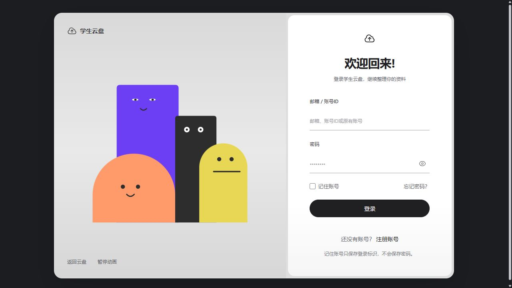
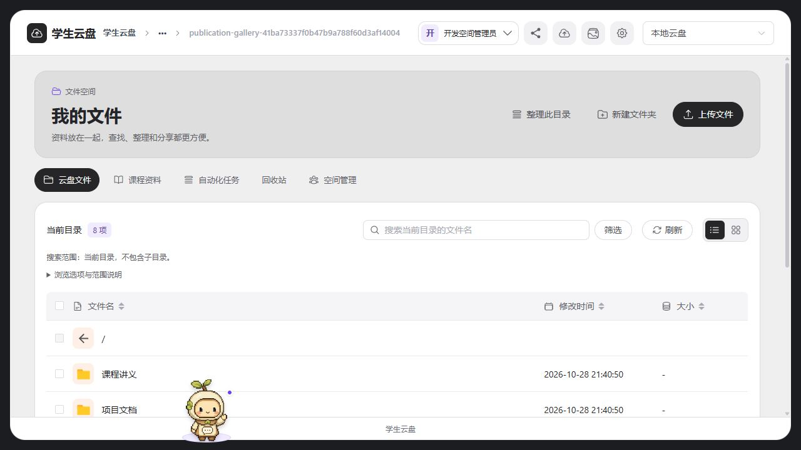
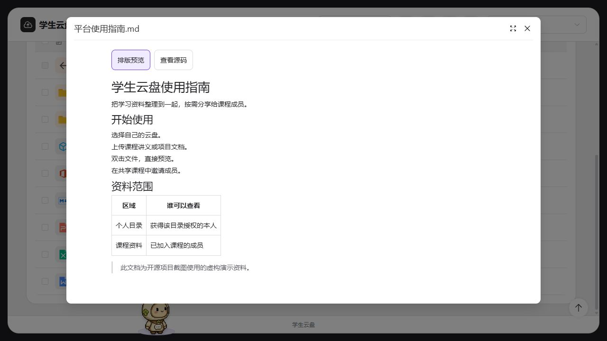
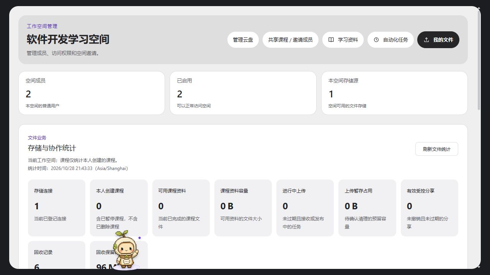
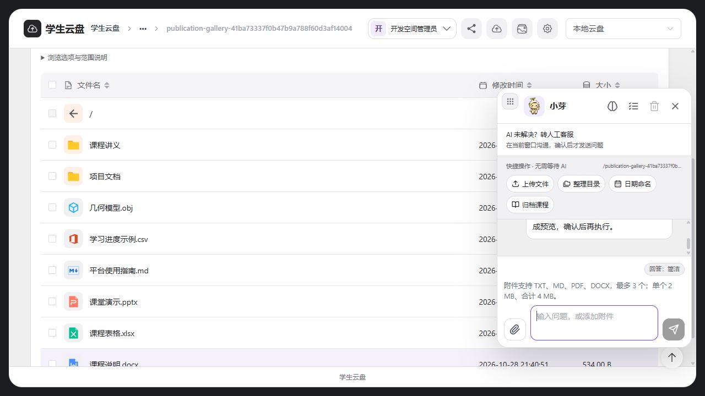
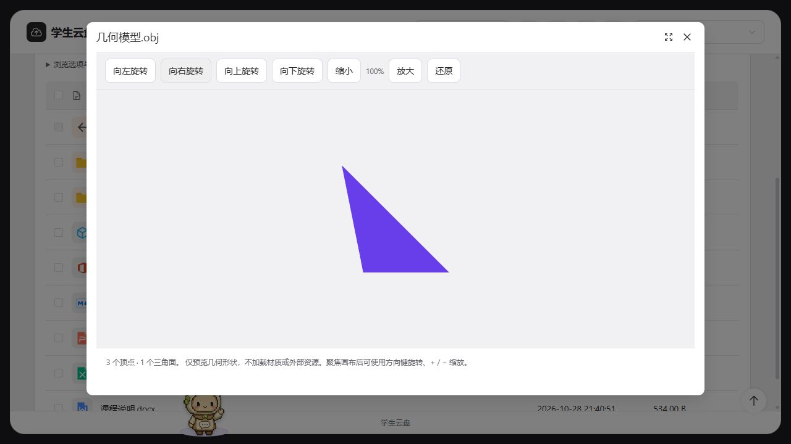
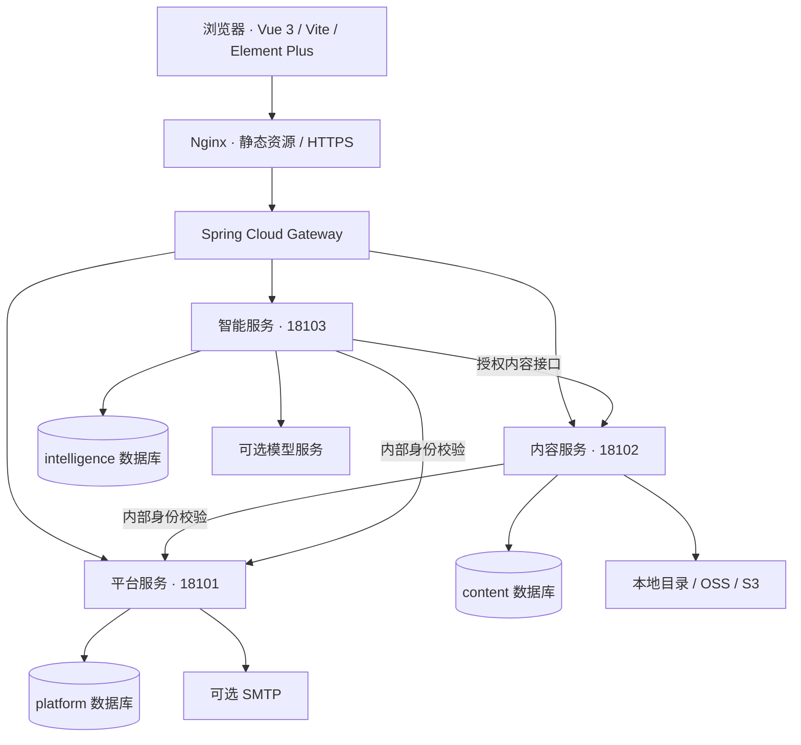

<div align="center">

# Student Cloud

### 学生云盘与智能资料管理平台

**把个人文件、课程资料和团队协作，放进一个有清楚权限边界的工作空间。**


**[在线界面预览](https://le5676922-max.github.io/student-cloud/)** · [快速启动](#quick-start) · [功能介绍](#features) · [微服务架构](#architecture) · [使用文档](docs/README.md)



</div>

> **当前开发主线：独立 Spring Cloud 后端。** 平台服务、内容服务、智能服务分别运行，Gateway 作为统一入口，共 **4 个 Java 进程**。最新代码在 [`backend-independent/`](backend-independent/)。历史 [`backend/`](backend/) 和 `docker/v4`、`docker/v5` 保留供迁移与溯源，不是本 README 的默认启动目标。前端包版本仍为 `5.0.0`，新后端开发版本为 `0.1.0-SNAPSHOT`。

## 先看一眼

[GitHub Pages 展示页](https://le5676922-max.github.io/student-cloud/)可切换查看最新真实界面，不需要注册。它是**静态展示**，不提供真实登录、上传或 AI 调用；完整使用需运行前后端。

截图更新于 **2026-10-28**，来自当前本地源码与虚构演示资料，不是设计效果图，也不展示真实用户文件或公开测试账号密码。

|                                   文件管理                                    |                                           资料预览                                           |
| :---------------------------------------------------------------------------: | :------------------------------------------------------------------------------------------: |
| [](docs/showcase/images/files.jpg) | [](docs/showcase/images/markdown.jpg) |
|                         **上传、查找、整理学习资料**                          |                                 **在当前页面阅读文档与源码**                                 |

<details>
<summary><strong>更多界面：空间管理、小芽 Agent、三维预览</strong></summary>

### 空间管理

普通管理员管理自己的空间、成员、云盘和课程；全局治理与成员日常授权分开。



### 小芽助手

上传入口、整理目录、日期命名、课程归档与长期记忆放在同一面板。支持的写操作先预览，再确认。



### 模型预览

OBJ / STL 在本地浏览器显示几何内容，可旋转、缩放与键盘还原，不加载文件内的外部材质。



</details>

<a id="features"></a>

## 项目能做什么

Student Cloud 面向学生、课程小组和学习团队，将**多存储文件管理、工作空间协作、课程共享、知识检索和可确认执行的 Agent** 组织在一起。基础文件功能可以独立使用，邮件、模型服务和其他基础设施按需配置。

| 日常需求           | 项目提供的流程                                                   |
| ------------------ | ---------------------------------------------------------------- |
| 保存自己的资料     | 申请云盘 → 管理员授权目录与容量 → 上传、预览、下载和整理         |
| 给学习团队分配空间 | 创建空间 → 邀请成员或处理加入申请 → 按成员设置访问范围           |
| 给课程共享讲义     | 创建课程 → 导入资料 → 生成邀请 → 成员加入后共享课程内容          |
| 控制课程上传       | 参与者申请上传权限 → 创建课程的管理员批准 → 可持续上传，亦可撤销 |
| 从资料里寻找答案   | 使用项目知识、已审核问答和本人授权资料进行检索与回答             |
| 减少重复整理       | 生成分类、日期重命名或归档方案 → 用户确认 → 再鉴权执行           |
| 改进答错的问题     | 点击“未解决” → 管理员整理 → 可选 AI 润色 → 审核发布知识          |

### 文件与存储

- **本地存储**：浏览、上传下载、创建目录、重命名、复制、移动和回收等操作按权限开放；写入遵守不覆盖已有目标的约束。
- **远程存储**：接入阿里云 OSS、S3 兼容存储及 MinIO 协议；支持授权目录读取、新建目录和 50 MiB 内的受控上传。当前不开放远程复制、移动、重命名、删除、回收与分享。
- **连接识别与验证**：识别地址格式；只读探测与写入测试分开。明确选择写入测试后，写入随机探针、读回核对、精确清理，并如实报告清理结果。
- **个人目录与容量**：普通管理员为成员分配目录、操作范围和容量上限，成员不能仅凭路径访问他人资料。
- **本地盘审批**：普通管理员可添加本空间远程云盘；使用服务器本地目录需要全局管理员同意。
- **上传下载**：本地分块续传、任务状态与失败恢复；支持的浏览器可流式保存下载文件，减少整文件前端内存占用。
- **回收与分享**：本地删除进入保留期内可恢复的回收流程；分享必须登录，不因持有链接绕过授权。

### 私有文件预览

双击支持的文件即可在当前页面查看，不默认把私有文件链接提交给外部 Office 或在线转换网站。

| 类别       | 格式示例                                   | 预算与说明                                                     |
| ---------- | ------------------------------------------ | -------------------------------------------------------------- |
| 图片       | PNG、JPEG、GIF、WebP、BMP                  | 20 MiB / 2000 万像素；缩放、旋转、还原                         |
| PDF        | PDF                                        | 20 MiB；本地查看、翻页、缩放                                   |
| 文本与代码 | TXT、JSON、YAML、Java、Python、JS、HTML 等 | 1 MiB，UTF-8；高亮与完整源码；HTML/脚本只作为源码显示          |
| Markdown   | MD、Markdown                               | 1 MiB；标题、列表、表格与源码切换                              |
| 表格       | CSV、TSV                                   | 1 MiB；有界解析、表格与分页                                    |
| Office     | DOCX、XLSX、PPTX                           | 10 MiB；文字与表格只读预览，不保证原版排版，不执行宏或计算公式 |
| 音视频     | MP3、WAV、FLAC、MP4、WebM 等               | 50 MiB；浏览器支持的编码，不含转码或 HLS                       |
| 模型       | OBJ、ASCII / 二进制 STL                    | 10 MiB；本地几何渲染，不加载材质与外链                         |

后端检查格式、实际字节、解压预算和访问权限；关闭弹窗会取消旧请求并释放 Worker、Blob URL 和模型资源。完整边界见[私有预览使用说明](docs/私有文件预览功能与使用说明-2026-10-28.md)。

### 课程协作

课程成员与空间成员是不同的业务关系：**加入课程不会改变原工作空间，也不会获得他人的私人云盘权限。**

1. 普通管理员创建课程并导入资料。
2. 创建一个或多个邀请码，可长期有效、设置到期时间、限定加入人数或主动撤销。
3. 普通成员、其他空间的普通管理员均可登录后确认加入。
4. 参与者按课程授权查看共享资料；上传权限由课程创建者批准，可持续使用，亦可撤销。

### 小芽 Agent 与知识维护

小芽提供资料问答，也为支持的文件操作生成可检查的方案。上传会打开文件选择入口，不能静默读取用户电脑上的文件。

```text
提出任务 → 生成操作预览 → 核对目标与数量 → 用户确认
                                        ↓
查看执行结果 ← 持久任务与状态记录 ← 再次鉴权并执行
```

- **整理自动化**：分类、日期命名和本人资料归档；定时规则生成待确认任务，不会无人确认地批量改写文件。
- **长期记忆**：保存用户明确提供的偏好，可查看、编辑、关闭和删除，不自动将全部聊天变成共享知识。
- **资料检索**：项目说明、审核知识与有权访问的个人资料按范围检索，回答可展示相关来源。
- **人工客服**：用户确认后在助手内联系全局管理员，WebSocket 通知与历史消息协同；“未解决”不强制转人工。
- **知识改进**：管理员整理正确答案，AI 辅助草稿，审核后发布，保留版本与撤回流程。

```text
未解决反馈 → 人工核对 → 可选 AI 润色 → 审核范围 → 确认发布 → 后续检索使用
```

这是**检索知识更新**，不是自动微调大模型。独立后端当前使用有界词法检索；外部 embedding、完整向量检索仍需后续接线与验收，不能把兼容配置当作已运行能力。

## 角色与数据范围

| 角色                      | 范围                               | 典型职责                                                 |
| ------------------------- | ---------------------------------- | -------------------------------------------------------- |
| 成员 `USER`               | 本人授权目录、本人索引、已加入课程 | 文件使用、加入课程、申请上传、问答与反馈                 |
| 普通管理员 `TENANT_ADMIN` | 所属空间与本人创建的课程           | 加入审批、成员密码重置、目录容量授权、云盘接入、课程管理 |
| 全局管理员 `ADMIN`        | 站点与全局资源治理                 | 全局信息、工作空间治理、本地存储审批、客服、知识审核     |

- 普通管理员完成邮箱验证后创建空间，无需额外审核。
- 成员凭空间邀请码直接加入；凭空间名称提交申请，等待对应管理员审批。
- 支持邮箱、系统唯一账号 ID 和兼容的原有用户名登录。
- 业务访问默认要求登录，不开放匿名云盘浏览；公开注册不能成为全局管理员。
- 业务权限隔离普通用户数据；持有服务器、数据库管理权的运维人员不属于普通用户隔离模型。

<a id="architecture"></a>

## 当前架构

当前开发主线使用 **Spring Cloud 微服务**，不是把旧后端复制成三个实例。



| 进程                         | 职责                                              | 默认端口 |
| ---------------------------- | ------------------------------------------------- | -------- |
| `cloud-platform-service`     | 账号、登录注册、工作空间、成员管理、人工客服      | 18101    |
| `cloud-content-service`      | 云盘、驱动、文件、权限容量、课程与资料            | 18102    |
| `cloud-intelligence-service` | 小芽、记忆、知识、反馈、自动化任务                | 18103    |
| `cloud-gateway`              | 统一 API 入口、路由、服务发现、负载均衡与受限熔断 | 18093    |

一个 MySQL 实例可承载三个专属数据库与账号；服务通过内部接口协作，不跨库 JOIN。16 个 Maven 模块组织契约、业务实现、适配器与运行服务；构建规则约束新服务不依赖历史后端实现。

| 层次       | 当前实现                                                                    |
| ---------- | --------------------------------------------------------------------------- |
| 前端       | Vue 3、Vite、Element Plus、Pinia、TypeScript / JavaScript                   |
| 后端       | Java 21、Spring Boot 4.1.2、Spring Cloud 2025.1.4                           |
| 服务治理   | Gateway、LoadBalancer、SimpleDiscoveryClient、CircuitBreaker / Resilience4j |
| 数据       | MySQL 专属库与账号；H2 用于默认隔离开发与测试                               |
| 文件       | 独立文件内核、本地与 OSS/S3 适配器、受控上传与状态记录                      |
| 异步与助手 | 持久任务、Outbox、确认式操作、受控知识发布                                  |
| 交付       | Docker Compose、Nginx、健康检查、非 root 运行、持久目录                     |

**Redis 在新后端中目前只有可选基础设施模板，尚未完成业务缓存接线。** 初期 ECS 采用固定内网地址发现，不额外强制运行 Nacos、Eureka、Seata 或消息队列。

<a id="quick-start"></a>

## 快速启动：运行当前独立版本

要求 JDK **21**、Maven **3.9+**、Node.js **>=22.13.0**、pnpm **11.19.0**。容器方案还需 Docker、Compose **v2.17+** 和 OpenSSL。仓库未附 Maven Wrapper。

```bash
git clone https://github.com/le5676922-max/student-cloud.git
cd student-cloud
```

### 方案 A：Docker Compose + MySQL

以下为 Linux / Ubuntu 示例，使用当前独立微服务配置，不使用历史 `docker/v5`。

```bash
# 1. 在仓库根目录构建新后端；省略测试用于构建，不代替验收。
mvn -f backend-independent/pom.xml -DskipTests package

# 2. 进入当前部署目录。
cd backend-independent/deploy/microservices

# 3. 首次生成随机密码与密钥，已有 .env 时拒绝覆盖。
sh prepare-env.sh

# 4. 准备三个互不重叠的内容服务目录。
sudo install -d -o 10001 -g 10001 -m 0700 \
  data/managed data/courses data/uploads

# 5. 静默检查配置，不打印含密码的展开结果。
docker compose config --quiet

# 6. 构建并启动前端、网关、三个业务服务和 MySQL。
docker compose build
docker compose up -d
docker compose ps

# 7. 检查初始化状态。
curl --fail http://127.0.0.1:18094/api/install/status
```

访问 **http://127.0.0.1:18094**。首次自行设置站点名称和全局管理员账号密码；没有公开的默认管理员密码。

```bash
# 查看应用日志。
docker compose logs --tail=80 gateway platform content intelligence

# 停止环境，保留数据库卷。
docker compose down
```

模板只绑定本机入口，不直接接管现有网站的 80/443。服务器部署还需配置域名、来源、HTTPS 和内网地址，详见[完整微服务部署说明](backend-independent/deploy/microservices/README.md)。配置模板不是已完成生产压测或线上切换的证明。

### 方案 B：本地源码开发

构建后在四个终端分别运行服务，为它们设置**相同的随机 `SC_INTERNAL_KEY`**，长度为 32–200 个字符，不提交到仓库。

```bash
mvn -f backend-independent/pom.xml -DskipTests package

# 以下命令分别在四个终端运行，各终端先配置 SC_INTERNAL_KEY。
java -jar backend-independent/cloud-platform-service/target/cloud-platform-service-0.1.0-SNAPSHOT.jar
java -jar backend-independent/cloud-content-service/target/cloud-content-service-0.1.0-SNAPSHOT.jar
java -jar backend-independent/cloud-intelligence-service/target/cloud-intelligence-service-0.1.0-SNAPSHOT.jar
java -jar backend-independent/cloud-gateway/target/cloud-gateway-0.1.0-SNAPSHOT.jar
```

默认业务服务使用独立 H2 内存数据库，退出不保留数据。MySQL 模式需为各服务设置 `SC_DB_URL`、`SC_DB_USER`、`SC_DB_PASSWORD`，并添加 `--spring.profiles.active=mysql`；三个服务分别连接自己的库与账号。目录和存储主密钥见[独立后端说明](backend-independent/README.md)。

另开终端启动前端：

```bash
cd frontend
pnpm install --frozen-lockfile

# Linux / macOS：两项变量均要设置，再启动 Vite。
CLOUD_API_TARGET=http://127.0.0.1:18093 \
CLOUD_BACKEND_MODE=microservices \
pnpm dev --host 127.0.0.1 --port 5173 --strictPort
```

Windows PowerShell：

```powershell
cd frontend
pnpm install --frozen-lockfile
$env:CLOUD_API_TARGET = 'http://127.0.0.1:18093'
$env:CLOUD_BACKEND_MODE = 'microservices'
pnpm dev --host 127.0.0.1 --port 5173 --strictPort
```

打开 **http://127.0.0.1:5173/**。修改代理变量后需重新启动 Vite。

### 可选服务与两台 ECS

| 能力      | 配置入口                                                              | 当前边界                                                                    |
| --------- | --------------------------------------------------------------------- | --------------------------------------------------------------------------- |
| QQ SMTP   | 平台服务 `SC_MAIL_ENABLED`、`SC_SMTP_USERNAME`、`SC_SMTP_PASSWORD` 等 | 使用授权码，默认关闭；独立版本真实外网投递需验收                            |
| 模型问答  | 智能服务 `SC_AI_*`                                                    | 自行提供地址、模型与密钥，不写入公开源码                                    |
| OSS / S3  | 内容服务主密钥与管理页连接配置                                        | `SC_STORAGE_MASTER_KEY` 为 32 字节 Base64，凭据加密；自建 endpoint 显式放行 |
| Redis     | Compose 可选 profile                                                  | 基础设施已准备，业务缓存接线未完成                                          |
| Embedding | 兼容配置与后续接线                                                    | 聊天模型不等于嵌入模型，未接通不宣称已启用向量检索                          |

两台阿里云 ECS 的初始布局：A 运行 MySQL、平台、Gateway 和前端，B 运行内容与智能服务，通过 VPC 私网互通。内存预算、端口和单实例状态限制见[微服务部署指南](backend-independent/deploy/microservices/README.md)。

## 验证与当前边界

以下为 **2026-10-28 本地预览升级**的记录，不将不同历史轮次合并成一次全站测试：

| 范围                         | 记录结果                                                       |
| ---------------------------- | -------------------------------------------------------------- |
| 前端完整 Node 测试集         | 984 通过，0 失败、0 跳过                                       |
| 内容服务及其 Maven 依赖模块  | 382 项：378 通过、4 项 Windows 符号链接条件跳过，0 失败        |
| Gateway + MySQL 真实预览接口 | 78 项断言通过，覆盖权限、MIME、内容与无效格式等                |
| 类型检查与生产构建           | 通过；Vite 仍提示部分既有大体积 chunk                          |
| 实际浏览器                   | 验证文档、图片、PDF、WAV、模型、错误提示、Escape 和 390px 窄屏 |

四个符号链接用例不计为通过。MP4 本轮覆盖容器头、鉴权与解码错误提示，**未验证真实完整视频成功播放**。真实 OSS/S3 账号、QQ SMTP、完整压力测试和生产安全整改不能由上述本地结果替代。

```bash
# 仓库根目录：当前新后端全模块校验。
mvn -f backend-independent/pom.xml verify

# frontend 目录：类型、回归与构建。
pnpm typecheck
pnpm test:unit
pnpm build
```

独立版本仍在持续完善，不能声称已替代历史部署全部功能。当前待完善包括 WebDAV/FTP/SFTP 独立驱动、远程写操作完整生命周期、Redis 业务缓存、向量检索接线、课程材料独立全文索引、原版 Office/复杂模型格式和多实例一致性。Agent 不提供任意 Shell、任意删除或绕过确认的权限修改。

## 仓库结构

```text
student-cloud/
├── backend-independent/         当前 Spring Cloud 独立实现
│   ├── cloud-platform-service/  账号、空间与客服
│   ├── cloud-content-service/   文件、课程与权限容量
│   ├── cloud-intelligence-service/ 小芽、知识与任务
│   ├── cloud-gateway/           统一入口
│   ├── cloud-*/                业务契约、领域、应用与适配模块
│   └── deploy/microservices/    当前 Docker / Nginx / ECS 配置
├── frontend/                   当前 Vue 前端与交互测试
├── docs/showcase/              GitHub Pages 展示页和最新截图
├── docs/                       使用说明、架构与验证记录
├── .github/workflows/           自动校验与展示页发布
├── backend/                    历史单体，非当前主线启动目标
├── docker/                     历史部署与辅助配置
├── DESIGN.md                   已采用的主题与视觉规范
├── UX-CONTRACT.md              交互、权限与异步恢复约定
└── LICENSE                     许可证与版权声明
```

## 继续阅读

| 想了解什么                     | 文档                                                                          |
| ------------------------------ | ----------------------------------------------------------------------------- |
| 当前服务职责、配置与限制       | [独立后端 README](backend-independent/README.md)                              |
| Docker、Nginx、MySQL、两台 ECS | [微服务部署指南](backend-independent/deploy/microservices/README.md)          |
| 注册、空间加入与 QQ SMTP       | [邮箱配置](backend-independent/deploy/microservices/邮箱注册与QQ-SMTP配置.md) |
| OSS / S3 接入与读写测试        | [远程存储指南](docs/OSS与S3远程存储接入指南.md)                               |
| 文档、媒体和模型预览           | [私有预览说明](docs/私有文件预览功能与使用说明-2026-10-28.md)                 |
| 小芽知识维护与审核发布         | [知识库维护手册](docs/知识库内容与维护手册.md)                                |
| 服务边界与架构决策             | [Spring Cloud 架构计划](docs/Spring-Cloud微服务架构与实施计划.md)             |
| 全部说明和历史记录             | [文档导航](docs/README.md)                                                    |

## 开源许可与来源

仓库按 [MIT License](LICENSE) 管理。**历史代码基于 [ZFile](https://github.com/zfile-dev/zfile) 扩展；当前 `backend-independent` 是不调用历史后端实现的独立重写。** 历史代码、仍复用的前端与第三方组件继续保留其版权和许可，后端重写不改变原有代码的来源。

登录角色组件包含 [CareerCompass](https://github.com/arsh342/careercompass) 的 MIT 授权代码，见[许可声明](frontend/public/licenses/careercompass.txt)。其他依赖和资源遵循各自许可。

欢迎提交可复现的 Issue 或 Pull Request。贡献前阅读 [CONTRIBUTING.md](CONTRIBUTING.md)，安全问题按 [SECURITY.md](SECURITY.md) 私下反馈；不要在公开 Issue 中粘贴密钥、密码或私人文件。
