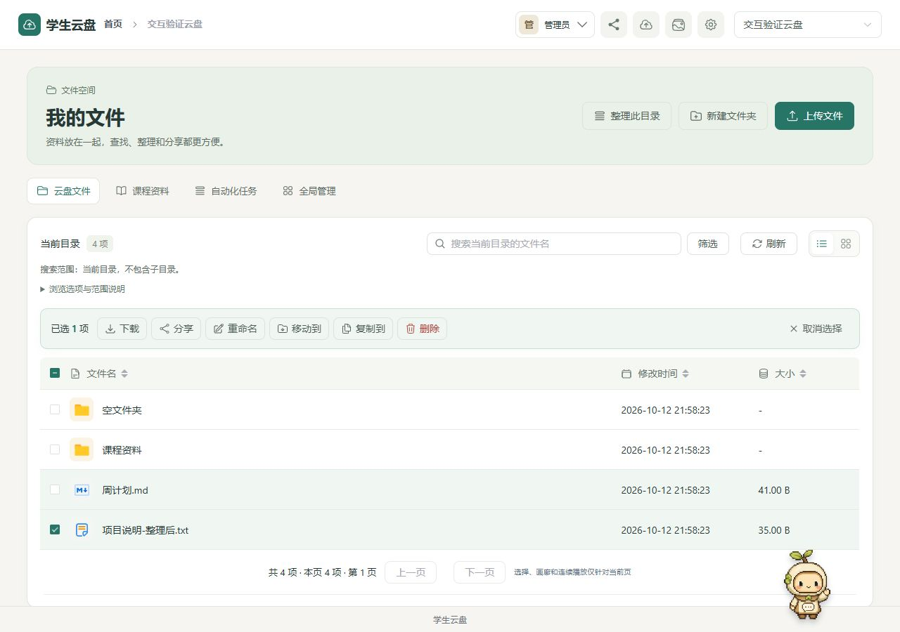

# 学生云盘与智能资料管理平台

面向个人学习与团队资料协作的云盘应用：管理文件、组织课程资料，并通过“小芽”助手检索和整理内容。

[快速开始](docs/QUICKSTART.md) · [Docker 部署](docs/Docker生产部署与验收-20261011.md) · [文档导航](docs/README.md) · [安全说明](SECURITY.md) · [贡献指南](CONTRIBUTING.md)


## 项目介绍

本项目基于开源云盘 [ZFile](https://github.com/zfile-dev/zfile) 扩展，围绕学生资料管理补充工作空间、邮箱注册、课程资料库、Agent 自动化及交互可靠性。采用前后端分离、模块化单体架构；不是微服务系统，也不要求配置模型密钥才能使用基础云盘。



> 截图来自独立测试环境，使用虚构的文件与目录，不包含真实用户资料。

## 主要功能

| 模块 | 能力 |
| --- | --- |
| 文件管理 | 上传、下载、预览、分享、重命名、移动、复制、删除；列表与卡片视图、目录分页、可见选择操作栏 |
| 多存储接入 | 本地、S3 兼容对象存储及现有协议适配；操作能力随存储源和用户授权变化 |
| 可靠上传 | 本地代理上传支持分片、断点续传、失败重试及独立暂存配额；不表示所有云存储协议均支持续传 |
| 账号与空间 | 邮箱或系统账号 ID 登录、邮箱验证注册、邮件找回密码、邀请码加入与空间名称申请审核 |
| 分级管理 | 全局管理员管理站点和空间；空间管理员管理本空间；成员使用获授权的文件与学习功能。常规云盘访问需要登录 |
| 课程资料库 | 按课程、学期和标签组织资料；授权文档正文检索、来源片段引用、文件变动后的索引路径同步 |
| 小芽与 Agent | 流式问答、辅助上传、文件分类和课程归档；自动化采用“预览—确认—执行—结果”流程 |
| 全局控制台 | 平台总览、按空间查看管理员与成员、存储连接治理、分享审计与日志诊断 |

### 设计重点

- **操作有边界**：文件操作绑定账号、空间、存储源和目录上下文；确认后再次校验权限。切换页面后的旧响应不会覆盖当前页面。
- **减少无效等待**：目录分页、请求合并、短时元数据缓存和预览按需加载；失败时提供持续错误提示及原请求重试。
- **自动化可确认**：Agent 不绕过文件授权；写操作须确认，状态不明确的任务不会被当作成功或盲目重放。
- **模型按需接入**：聊天和 embedding 独立配置；语义检索默认关闭，未配置或调用失败时明确使用关键词检索。可选本地 OCR 不向模型发送扫描图片。
- **缓存不替代权限**：可选 Redis 用于指定元数据缓存与共享限流，不作为用户权限判断依据，也不等同于分布式会话改造。

## 技术栈

| 层次 | 技术 |
| --- | --- |
| 前端 | Vue 3、TypeScript / JavaScript、Vite、Element Plus、Pinia |
| 后端 | Java 21、Spring Boot 3、MyBatis-Plus、Sa-Token |
| 数据与迁移 | MySQL 8、Flyway；SQLite 仅用于独立本地演示和部分测试 |
| 可选服务 | Redis、SMTP、聊天模型 API、embedding API、Tesseract OCR |
| 部署 | Docker Compose、Nginx、MySQL、单个后端实例 |

## 快速运行

环境要求：JDK **21**、Maven **3.9+**、Node.js **>=22.13.0**（建议 24 LTS）、pnpm **11.19.0**、MySQL **8**。

```bash
git clone https://github.com/le5676922-max/student-cloud.git
cd student-cloud
```

1. 创建空的 MySQL 数据库 `student_cloud`，设置数据库连接及密码；具体 SQL 和 Windows / Linux 命令见[快速开始](docs/QUICKSTART.md)。表结构由 Flyway 管理，不要用“重建数据库”脚本升级已有系统。
2. 在后端终端运行 `mvn -f backend/pom.xml spring-boot:run`，默认端口 `8080`。
3. 在另一个终端运行以下命令：

```bash
cd frontend
pnpm install --frozen-lockfile
pnpm dev --host 127.0.0.1 --port 5173 --strictPort
```

打开 `http://127.0.0.1:5173`，首次运行按初始化页面创建全局管理员；**没有公开的默认账号密码**。未配置 SMTP 时不能使用邮箱自助注册和邮件找回密码，已初始化的账号仍可登录。

数据库密码、SMTP 授权码和模型密钥只放在私有配置或后端环境变量中。`VITE_*` 会暴露给浏览器，不能放秘密。仓库仅提供配置模板。

### Docker + Nginx

仓库提供从源码构建的四服务方案：Nginx 前端、后端、MySQL、Redis。仅 Nginx 对外发布端口；数据库与业务文件保存在独立持久卷。

```bash
# 在仓库根目录操作；不覆盖已有私密配置，新复制后须替换密码和站点地址。
cp -n docker/.env.production.example docker/.env.production
chmod 600 docker/.env.production

# 先编辑配置；不要直接使用示例密码启动生产服务。
nano docker/.env.production

# 静默验证，避免把解析后的真实秘密打印到终端。
docker compose --env-file docker/.env.production -f docker/compose.production.yml config --quiet
docker compose --env-file docker/.env.production -f docker/compose.production.yml up --build -d --wait
```

域名、HTTPS、安全组、首次安装、日志与上线验收，请按 [Docker 详细部署指南](docs/Docker生产部署与验收-20261011.md) 操作。生产环境不要运行 Vite 开发服务器，也不要开放 MySQL、Redis 和后端端口到公网。

## 测试与验证

```bash
# 后端：默认使用隔离测试环境，真实外部服务测试需显式配置。
mvn -f backend/pom.xml verify

# 前端：在 frontend 目录运行。
pnpm typecheck
pnpm test:unit
pnpm lint
pnpm build
```

最近验证范围与限制：

- 前端回归、类型检查、ESLint、生产构建及桌面 / 移动端浏览器验证，见[文件交互验证记录](docs/开源云盘参考与交互优化-20261012.md)。
- 后端及隔离 MySQL 业务测试，见[业务验收报告](docs/业务修复与验收报告-20261012.md)。测试报告标明日期和跳过项，不把历史结果当作当前生产承诺。
- GitHub Actions 配置覆盖前后端、隔离 MySQL / Redis 和 Docker 验收；是否通过请查看仓库的 **Actions** 页面。

未完成真实服务验收的集成、第三方存储协议和性能容量不能仅凭单元测试判定可用。

## 目录结构

```text
student-cloud/
├── backend/          Spring Boot 服务、业务模块与 Flyway 迁移
├── frontend/         Vue 页面、文件预览与前端回归测试
├── docker/           Compose、配置模板与 HTTPS 扩展
├── database/         手工重建脚本，仅限明确需要清空的数据库
├── scripts/          验证与 HTTP / 部署冒烟测试
├── docs/             启动、权限、Agent、部署与验收说明
├── .github/workflows/ GitHub Actions
└── LICENSE           MIT 许可证与原版权声明
```

## 当前边界

- 生产保持 **一个后端实例**。登录会话、Agent 队列等尚未完成多实例改造，引入 Redis 不代表可以直接横向扩容。
- Agent 写入自动化目前限定已支持的本地存储操作，并要求用户确认。
- embedding 需要独立的向量模型服务；聊天模型密钥不能直接代替 embedding 配置。
- OCR、真实对象存储、SMTP、容器网络及服务器负载需要部署者使用自己的隔离样例验收。
- 文件预览仍存在部分较大懒加载模块和第三方样式构建警告，尚未承诺所有旧浏览器兼容。

## 开源与致谢

本仓库保留 ZFile 的原有版权和 [MIT 许可证](LICENSE)。项目扩展与上游功能应如实区分，二次分发请保留许可证及版权声明。

登录角色组件包含 [CareerCompass](https://github.com/arsh342/careercompass) 的 MIT 授权代码，完整声明见 [careercompass.txt](frontend/public/licenses/careercompass.txt)。其他依赖、字体和资源遵循各自许可；交互参考与未复制源码的范围见[开源参考说明](docs/开源云盘参考与交互优化-20261012.md)。

欢迎通过 Issue 提供可复现问题；提交前请阅读[贡献指南](CONTRIBUTING.md)。安全问题和凭据泄露请按[安全说明](SECURITY.md)私下处理，不要发布密码、令牌或私人文件。
