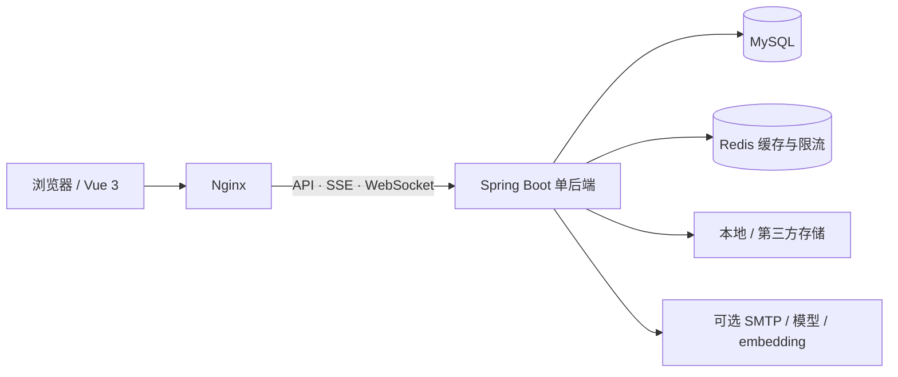

<div align="center">

# Student Cloud

### 学生云盘与智能资料管理平台

**把个人文件、课程协作和资料检索放在同一个工作空间。**


[完整使用手册](项目介绍与使用手册.md) · [本地启动](docs/QUICKSTART.md) · [Docker 部署](docs/Docker生产部署与验收-20261011.md) · [文档导航](docs/README.md)

</div>

---

Student Cloud 面向学生、课程小组及学习团队，提供多存储云盘、分级空间管理、跨空间课程共享，以及可确认执行的小芽 Agent。基础云盘可独立使用，邮件、模型与语义检索按需接入。

| 整理文件 | 协作学习 | 减少重复工作 |
| :--- | :--- | :--- |
| 多存储接入、个人目录与容量 | 共享课程、独立邀请与上传审批 | 资料检索、确认执行与反馈改进 |

**快速浏览：** [功能](#features) · [角色](#roles) · [架构](#architecture) · [启动](#getting-started) · [容器部署](#deployment) · [测试](#verification) · [文档](#documentation)


*阶段性功能截图，来自隔离测试环境；文件与目录使用虚构数据。页面细节可能随版本变化，不代表完整的最新界面。*

<details>
<summary><strong>查看个人资料库界面</strong></summary>


这张阶段性截图展示本人可见的学习索引页。跨空间共享课程使用独立入口和授权，不与个人资料库混用。

</details>

<a id="features"></a>

## 平台能做什么

| 场景 | 对应功能 |
| --- | --- |
| 保存自己的学习文件 | 申请个人云盘，按授权目录上传、下载、预览、整理与分享 |
| 给一个学习团队分配空间 | 管理成员、处理加入申请、重置成员密码、分配目录与容量上限 |
| 向一门课程分发资料 | 创建共享课程，生成邀请链接，设置有效期、人数上限或随时停用 |
| 与其他空间一起学习 | 成员和普通管理员均可跨空间加入课程，共享范围仅限该课程 |
| 从资料中找答案 | 按文件名、标签和授权文档正文检索，回答展示资料来源 |
| 减少重复整理操作 | 小芽生成分类、日期重命名或个人资料归档方案，确认后执行 |
| 处理没有解决的问题 | 保存反馈、联系人工客服，由管理员整理正确答案并审核发布知识 |

### 01 · 云盘与空间协作

- 支持本地、S3 兼容对象存储及现有协议适配；自动识别连接地址格式，实际能力以驱动和授权为准。
- 文件列表支持分页、搜索、卡片与表格视图、批量选择和按需预览；本地代理上传支持分片、断点续传及失败重试。
- 成员可主动申请使用云盘，由所属普通管理员审批，并设置个人目录、操作权限及每存储源容量。
- 普通管理员可添加本空间第三方云盘；服务器本地盘须由全局管理员审批，避免任意占用服务器目录。
- 明确勾选写入测试后，LOCAL／S3 连接探针可验证写入、读回及清理；其他协议明确报告支持范围，不将只读通过当作写入成功。

### 02 · 共享课程

课程共享与私人云盘分开。加入课程不改变原工作空间，也不会获得他人的个人文件权限。

1. 普通管理员创建课程、导入资料。
2. 创建课程邀请码或链接，可同时保留多个独立邀请。
3. 邀请可长期有效、自定义到期时间、限制加入人数或主动停用；名额用尽后不再接受新账号。
4. 普通成员及其他普通管理员登录后预览并确认加入，即可查看课程资料。
5. 参与者先申请上传权限，由课程创建者批准后持续上传；创建者可撤销权限或移出成员。

详见[课程邀请与上传审批说明](docs/共享课程与成员邀请说明-20261025.md)。

### 03 · 小芽 Agent 与可维护知识库

小芽除了回答问题，还能在当前授权范围内查询文件、生成实际操作方案；上传时打开文件选择器，由用户选择文件并确认目标后上传。

```text
提出任务 → 生成方案 → 核对目标与数量 → 用户确认 → 再次鉴权并执行 → 查看结果
```

- **文件自动化**：本地文件分类、按日期重命名、将符合条件的资料加入本人学习索引；可配置每周规则，系统定期检查到期规则并生成待确认任务。
- **长期记忆**：按账号保存用户明确提供的偏好，支持查看、编辑、关闭和删除；不自动归档全部聊天。
- **资料问答**：项目说明与个人资料检索结合，语义检索使用独立、可选的 embedding 服务；未配置时使用关键词检索。
- **人工服务**：在助手内确认转接后，与全局管理员沟通；历史消息持久化，WebSocket 通知会话变更。
- **反馈改进**：点击“未解决”只记录该轮问答，不自动转人工。管理员核对答案、可选 AI 润色、预览后确认发布，支持版本记录与撤回。

```text
未解决反馈 → 人工纠正 → 可选 AI 润色 → 审核范围 → 确认发布 → 后续检索使用
```

这里的“知识改进”更新检索知识，不是自动训练模型参数。个人索引、共享课程文件与已发布问答分别维护，不会自动互相转换。

### 一次完整的使用流程

> 创建空间 → 添加第三方云盘或申请本地存储 → 邀请成员 → 审批个人目录与容量 → 创建课程 → 邀请参加 → 批准资料上传 → 检索与整理资料

<a id="roles"></a>

## 角色与数据范围

| 角色 | 管理范围 | 典型操作 |
| --- | --- | --- |
| 普通成员 `USER` | 本人获授权目录、本人资料库及已加入课程 | 申请云盘、使用文件、加入课程、申请上传、小芽问答 |
| 普通管理员 `TENANT_ADMIN` | 所属工作空间；本人创建的课程 | 审核成员、重置本空间成员密码、设置目录与容量、接入第三方云盘、创建课程 |
| 全局管理员 `ADMIN` | 站点、工作空间及全局资源治理 | 平台统计图表、空间启停、本地存储审批、连接治理、人工客服、知识维护 |

成员的日常文件授权由对应普通管理员处理；全局管理员不逐个编辑成员权限。公开注册只能创建普通管理员或成员，不能获得全局管理员身份。

- 注册普通管理员：完成邮箱验证后创建新空间，无需人工审核。
- 注册成员：凭空间邀请码直接加入；凭空间名称提交申请后等待审核。
- 登录支持邮箱、系统分配的唯一账号 ID，以及兼容的原有用户名。
- 未登录业务访问进入登录流程，云盘不开放匿名浏览。

<a id="architecture"></a>

## 架构与技术栈

采用前后端分离、按业务模块组织的**模块化单体架构**。



| 层次 | 技术 |
| --- | --- |
| 前端 | Vue 3、Vite、Element Plus、Pinia、TypeScript / JavaScript |
| 后端 | Java 21、Spring Boot 3、MyBatis-Plus、Sa-Token |
| 数据 | MySQL 8、Flyway 增量迁移；部分演示及隔离测试使用 SQLite |
| 缓存 | 内存缓存或 Redis 元数据缓存、共享限流 |
| 智能能力 | 聊天模型兼容接口、RAG、独立可选 embedding、本地可选 Tesseract OCR |
| 交付 | Docker Compose、Nginx、健康检查、持久卷与配置模板 |

目录查询采用分页、请求合并和短时缓存；权限在业务访问与写入前重新校验，缓存不作为授权依据。Nginx 保留流式回答、客服连接和分片上传所需的独立代理规则。

当前生产方案是 **Nginx + 一个后端 + Redis + MySQL**。登录会话、Agent 队列等仍有进程内状态，不能仅增加后端副本就认为完成多实例部署。

<a id="getting-started"></a>

## 本地启动

需要 JDK **21**、Maven **3.9+**、Node.js **>=22.13.0**、pnpm **11.19.0** 和 MySQL **8**。仓库不包含 Maven Wrapper。

```bash
git clone https://github.com/le5676922-max/student-cloud.git
cd student-cloud
```

先创建空的 `student_cloud` 数据库及项目专用账号，具体 SQL 见[快速开始](docs/QUICKSTART.md)。表结构由 Flyway 自动迁移，正常安装不需要导入重建脚本。

在后端终端设置私有配置后启动。以下为 Linux / macOS 示例，Windows PowerShell 写法见快速开始：

```bash
cd backend
export SPRING_DATASOURCE_USERNAME='你的数据库账号'
# 在当前终端安全设置 SPRING_DATASOURCE_PASSWORD，或使用忽略的私有配置文件。
export MAIL_ENABLED=false
export TLGXY_CLOUD_AI_ENABLED=false
export STUDENT_CLOUD_CACHE_TYPE=memory
mvn spring-boot:run '-Dspring-boot.run.arguments=--server.address=127.0.0.1'
```

另一终端启动前端：

```bash
cd frontend
pnpm install --frozen-lockfile
pnpm dev --host 127.0.0.1 --port 5173 --strictPort
```

访问 **`http://127.0.0.1:5173`**。新数据库首次进入初始化页面，由你自行设置全局管理员账号和密码；没有公开的默认密码。前端默认代理到 `http://127.0.0.1:8080`，后端端口不同可设置 `CLOUD_API_TARGET` 后重启 Vite。

初始化后，普通管理员添加第三方云盘或申请本地云盘，成员申请开通个人目录。注册成功不自动获得服务器本地存储。

<details>
<summary><strong>可选服务：邮件、模型、语义检索、Redis 与 OCR</strong></summary>

| 能力 | 后端配置入口 | 未配置时 |
| --- | --- | --- |
| QQ 邮件 | `MAIL_ENABLED`、`MAIL_USERNAME`、`MAIL_PASSWORD`、`MAIL_FROM`、`MAIL_CODE_SECRET`；SMTP 为 `smtp.qq.com:465` | 管理员初始化和登录可用，邮箱注册及找回密码不可用 |
| 聊天模型 | `TLGXY_CLOUD_AI_ENABLED`、`TLGXY_CLOUD_AI_BASE_URL`、`TLGXY_CLOUD_AI_API_KEY`、`TLGXY_CLOUD_AI_MODEL` | 基础云盘和规则任务预览仍可用 |
| 语义检索 | `STUDENT_CLOUD_EMBEDDING_ENABLED`、`BASE_URL`、`API_KEY`、`MODEL`、`DIMENSIONS`，均使用同一完整前缀 | 使用关键词检索 |
| Redis | `STUDENT_CLOUD_CACHE_TYPE=redis` 与 `STUDENT_CLOUD_REDIS_*` | 本地可使用内存缓存 |
| OCR | `STUDENT_CLOUD_OCR_ENABLED` 与 Tesseract 配置 | 扫描图片不视为已识别文字 |

数据库密码、SMTP 授权码和模型密钥通过后端环境变量或忽略的私有配置注入。配置模板为 [application-local-secrets.example.properties](backend/application-local-secrets.example.properties)。`VITE_*` 会进入浏览器，不能保存秘密。

</details>

<a id="deployment"></a>

## Docker 容器化部署

推荐先阅读[Docker + Nginx 详细教程](docs/Docker生产部署与验收-20261011.md)。通用方案从源码构建前后端，MySQL、Redis 和后端仅在容器网络内通信，由 Nginx 对外提供服务。

```bash
# Linux，项目根目录；已有配置不要覆盖。
cp -n docker/.env.production.example docker/.env.production
chmod 600 docker/.env.production

# 编辑站点地址、不同的随机数据库与 Redis 密码，以及需要的可选服务。
nano docker/.env.production

# 仅校验语法，不打印展开后的秘密。
docker compose --env-file docker/.env.production -f docker/compose.production.yml config --quiet

# 从源码构建并等待健康检查；首次需要下载依赖与基础镜像。
docker compose --env-file docker/.env.production -f docker/compose.production.yml up -d --build --wait
docker compose --env-file docker/.env.production -f docker/compose.production.yml ps
```

生产使用前需按教程配置域名、HTTPS 及安全组。数据库、文件和续传暂存必须持久化；课程文件根也须位于后端可写持久卷内，不能落到只读容器层。

[docker/v5](docker/v5/README.md) 另提供 V5 镜像发布、独立目录与资源预算模板。部署者需填写自己的镜像地址、站点与目录，不能假设可以访问作者的镜像仓库。Nginx 连接配置与资源上限不是并发承载保证，应在自己的服务器上验证。

<a id="verification"></a>

## 测试与验证

<details>
<summary><strong>展开测试、构建与只读站点验收命令</strong></summary>

```bash
# 仓库根目录：后端测试与打包。
mvn -f backend/pom.xml verify

# frontend 目录：类型、回归、规范和生产构建。
pnpm typecheck
pnpm test:unit
pnpm lint
pnpm build

# 仓库根目录：只读站点冒烟检查，不创建账号或修改文件。
node scripts/deployment-smoke.mjs https://你的域名
```

</details>

最近一轮专项记录（2026-10-25）：

| 验证范围 | 记录结果 |
| --- | --- |
| 本次发布前后端全量默认测试 | 共 1010 项：993 项通过，17 项按独立环境条件跳过；Maven `verify` 成功 |
| 课程与知识检索后端定向回归 | 69 项通过 |
| 隔离集成回归 | 54 项通过：52 项真实 HTTP + MySQL 工作流、2 项临时 SQLite 统计测试 |
| 前端完整回归 | 743 项通过，包含实际 Vue 组件的 JSDOM 交互 |
| 原先因环境跳过的项目 | 17 项补测全部通过，覆盖真实 Redis、合成问题模型调用、检索基准及 Linux 符号链接 |

本次发布前的前端类型检查、全量 lint 和 Compose 语法校验均通过。详见[源码发布检查](docs/公开发布检查-20261025.md)、[课程邀请验证记录](docs/共享课程与成员邀请说明-20261025.md)、[17 项专项补测报告](docs/17项专项补测报告-20261025.md)。这些是不同轮次、不同范围的记录，不合并冒充一次全量测试。JSDOM 不代替所有浏览器验证，真实邮箱投递、第三方存储与并发容量须按部署环境验收；GitHub CI 状态以仓库 Actions 为准。

<a id="documentation"></a>

## 目录与文档

```text
student-cloud/
├── backend/                  Spring Boot 模块、Flyway 迁移与后端测试
├── frontend/                 Vue 页面、交互组件与前端测试
├── docker/                   源码构建、Nginx、HTTPS 与版本部署模板
├── scripts/                  发布、隔离测试、站点冒烟与知识整理工具
├── database/                 手工重建脚本，不作为常规升级入口
├── docs/                     专项说明、部署教程与历史验证记录
├── 项目介绍与使用手册.md       按角色组织的完整使用流程
└── LICENSE                   MIT 许可证与原版权声明
```

- [完整使用手册](项目介绍与使用手册.md)：注册、云盘审批、课程、助手及控制台操作。
- [成员云盘、课程与知识改进](docs/云盘课程与知识改进操作说明-20261025.md)：业务规则与权限边界。
- [长期记忆](docs/小芽长期记忆-20261022.md)：记忆保存、编辑、关闭与删除。
- [知识反馈整理与发布](docs/知识库反馈整理与发布.md)：管理员操作及批量整理脚本。
- [全部文档](docs/README.md)：开发、部署、架构及验收说明。旧报告描述其记录日期的状态，当前操作优先参考使用手册及最新专项文档。

## 当前边界

- 受限成员的配额写入主要覆盖可准确计量的 LOCAL／S3；不同存储驱动的操作能力并不一致。
- Agent 写操作只执行已支持的本地任务，必须确认；不支持任意删除、覆盖文件或修改账号权限。
- embedding 服务与聊天模型分别配置；没有配置不能宣称启用了向量检索。
- 个人目录、课程、索引及记忆在业务接口中隔离；基础设施管理员仍具有服务器和数据库层面的管理能力。
- 外部模型可能接收用户选择的问题、资料片段或记忆，使用前应确认资料允许由相应服务处理。
- 当前没有覆盖全部存储协议的统一回收站、历史版本恢复或个人云盘全站用量账本。

## 开源许可与贡献

本项目基于 [ZFile](https://github.com/zfile-dev/zfile) 扩展，保留上游版权与 [MIT 许可证](LICENSE)。工作空间、课程协作、Agent、客服和知识改进等扩展不改变原代码的归属；二次分发应继续保留许可证及版权声明。

登录角色组件包含 [CareerCompass](https://github.com/arsh342/careercompass) 的 MIT 授权代码，见[许可声明](frontend/public/licenses/careercompass.txt)。其他组件、字体与资源遵循各自许可，交互参考记录见[开源参考说明](docs/开源云盘参考与交互优化-20261012.md)。

欢迎提交可复现的 Issue 或 Pull Request，提交前请阅读[贡献指南](CONTRIBUTING.md)。凭据、私人文件和安全漏洞不要公开贴到 Issue，请按[安全说明](SECURITY.md)处理。
