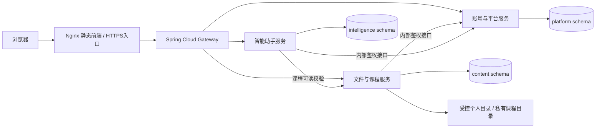

# Spring Cloud 微服务：本地与两台阿里云 ECS 配置

此目录用于新独立后端的隔离环境。**它不会自动替换现有网站，也不表示全部业务迁移已经完成。** 本轮提供配置和操作方法，没有在 ECS 上启动这些容器。实际编译与接口结果以根任务实施记录为准；正式切换应在业务迁移和验收完成后进行。

基线：Java21、Spring Boot4.1.2、Spring Cloud2025.1.4。本机四进程/三库 MySQL 基本流程已通过；镜像和本教程的 ECS 操作尚未执行，不能直接用于替换当前正式网站。[本轮实际结果](../../../docs/Spring-Cloud微服务实施记录-2026-10-26.md)

## 1. 真实服务边界



一个 MySQL 实例中创建三个独立 schema、三个数据库账号。每个账号只获得自己 schema 的权限，业务服务不直接查询其它服务的数据表。共享的是基础设施实例，不是可以随意跨服务 JOIN 的业务数据库。

| 进程 | 端口 | 所有业务 |
| --- | --- | --- |
| `cloud-platform-service` | 18101 | 账号、登录会话、空间管理员/成员管理、人工客服 |
| `cloud-content-service` | 18102 | 文件驱动、容量、个人目录授权、云盘审批、共享课程和资料 |
| `cloud-intelligence-service` | 18103 | 长期记忆、未解决反馈、审核知识、异步任务与助手后续能力 |
| `cloud-gateway` | 18093 | 路由、服务发现/负载均衡、受限熔断、WebSocket代理 |

默认采用静态地址配置的 Spring Cloud SimpleDiscoveryClient，不再额外启动 Nacos、Eureka、Seata 或消息队列。阿里云 ECS 可以正常运行标准 Spring Cloud；以后实例频繁变化时，再评估 Nacos/MSE，不能把这些未接入组件写成当前能力。

目前客服只运行一个 platform 实例，文件写入只运行一个 content 实例；复制这些进程前，必须处理共享文件位置、客服票据和跨实例通知等状态。

## 2. 文件作用

| 文件 | 用途 |
| --- | --- |
| `compose.services.yaml` | 通用镜像、容器限制、数据库账号、环境变量定义；一般不直接运行 |
| `compose.yaml` | 单机隔离联调，一次启动所有服务；前端仅绑定 `127.0.0.1:18094` |
| `compose.node-a.yaml` | ECS A：MySQL、platform、Gateway、Nginx 前端 |
| `compose.node-b.yaml` | ECS B：content、intelligence；Redis 为显式可选基础设施 profile |
| `Dockerfile.service` | 使用已构建的新服务 JAR，非 root 运行 JDK 21 应用 |
| `Dockerfile.frontend` | 从现有前端源码构建，使用本目录 Nginx 配置，不改原部署文件 |
| `mysql/01-service-databases.sh` | 仅在空 MySQL 卷第一次启动时创建三个库和各自账号 |
| `prepare-env.sh` | 一次生成随机凭据到被 Git 忽略的 `.env`；已有文件则拒绝覆盖 |
| `nginx/https-edge.conf.example` | 验收后用于主机 HTTPS 入口的示例，需要自己的域名及证书 |

Docker Compose 需支持 `build.additional_contexts`（2.17+）。本配置把 `frontend/` 与小型 `nginx/` 目录分别作为构建上下文，避免将整个旧项目和秘密配置提交给前端构建。

## 3. 本地隔离环境

以下示例在 Linux/Ubuntu shell 中执行，JDK 21 和 Maven 3.9+ 用于构建。可先在开发电脑构建镜像，再传到 ECS，避免 2 核服务器同时运行 Maven、前端构建和数据库。

```bash
# 在仓库根目录构建新后端；该命令跳过测试，不能用它代替业务验收。
mvn -f backend-independent/pom.xml -DskipTests package

# 进入新微服务部署目录。不要进入旧 docker/v5 目录。
cd backend-independent/deploy/microservices

# 首次生成随机密钥和密码，不覆盖已有 .env，也不会打印密码。
sh prepare-env.sh

# 新环境准备三个互不重叠的目录；content 容器使用 UID/GID 10001。
# uploads 存放分块暂存，不能放在可浏览的 managed 或 courses 中。
sudo install -d -o 10001 -g 10001 -m 0700 data/managed data/courses data/uploads

# 静默检查展开后的 Compose；不将包含密码的完整 config 输出到聊天或公开日志。
docker compose config --quiet

# JAR 已在上一步生成。构建应用与前端镜像。
docker compose build

# 启动隔离环境，不占用现有网站的 80/443。
docker compose up -d

# 查看容器是否健康，查看公开初始化状态。
docker compose ps
curl --fail http://127.0.0.1:18094/api/install/status
```

本地访问 `http://127.0.0.1:18094`，初始化账号自行设置。`.env` 的 `SC_ALLOWED_ORIGINS` 默认包含该本机来源。新 MySQL 使用单独命名卷，不导入旧数据库。

如果另外使用已有前端的 Vite 开发服务连接新网关，需同时配置两项：`CLOUD_API_TARGET=http://127.0.0.1:18093`、`CLOUD_BACKEND_MODE=microservices`，再启动 `pnpm dev`。后者保留浏览器 Origin，使 HTTP 票据和 WebSocket 来源一致；默认模式保留旧后端代理行为。仅用于已经迁移接口的联调，当前不要将日常旧环境整体切到新网关。

```bash
# 查看新服务日志；不要把 .env 或完整环境变量输出公开。
docker compose logs --tail=80 gateway platform content intelligence

# 停止此隔离环境。没有 -v，数据卷保持。
docker compose down
```

## 4. 两台 2核4GB ECS 的布局

两台 ECS 应位于可互通的同一 VPC，通过**私网 IP**连接服务和数据库。

| 节点 | 进程 | 容器内存上限 / Java 堆上限 |
| --- | --- | --- |
| A | MySQL | 1GiB / InnoDB buffer pool 512MiB |
| A | platform | 640MiB / 256MiB |
| A | Gateway | 384MiB / 128MiB |
| A | Nginx 静态前端 | 128MiB |
| B | content | 1GiB / 384MiB |
| B | intelligence | 768MiB / 256MiB |
| B，可选 | Redis 基础设施 | 192MiB / maxmemory 128MiB |

这些是初始限制，不是并发承载量或性能保证。剩余内存留给系统、页缓存、上传临时文件和以后明确需要的工作进程。Redis profile 目前只准备基础设施，没有业务缓存接线；默认不启动，不宣称它已经减少数据库查询。

### 4.1 配置私网与来源

在生成的 `.env` 中修改公开来源、节点 A/B 私网地址。两台机器使用相同的内部服务密钥与各服务数据库密码，保存为权限 `600` 的私有配置，不提交到 Git。

```dotenv
# 示例值，替换为实际 ECS 私网地址，不填公网 IP。
SC_NODE_A_IP=172.16.0.10
SC_NODE_B_IP=172.16.0.11
# 正式使用域名时必须与浏览器地址完全对应，不含末尾 /。
SC_ALLOWED_ORIGINS=https://cloud.example.com
```

安全组仅允许所需连接：A 的 3306、18101 接受来自 B 私网；B 的 18102、18103 接受来自 A 私网。不要将 MySQL、业务服务端口对全网开放。面向浏览器的最终入口由 A 的 HTTPS Nginx 提供。

Nginx 和 Gateway 使用单独的 Docker edge 网络，默认 `172.30.50.0/28`；Nginx 固定为 `172.30.50.2`，Gateway 仅信任这个明确代理地址。Nginx 前端端口仅发布到回环地址，并仅信任 Docker 主机网关 `172.30.50.1` 传来的 HTTPS edge `X-Real-IP`，避免全部用户共享同一个登录限流桶。若该网段与现有网络冲突，同步修改 `.env` 中 `SC_EDGE_SUBNET`、`SC_FRONTEND_EDGE_IP`、`SC_HTTPS_EDGE_PROXY_IP`；保留确切代理范围，不信任任意公网转发头。

### 4.2 构建并传输镜像

可在开发环境完成上文 `docker compose build`。将四个 Java 服务和前端镜像通过私有镜像仓库分发，或使用 Docker 自带离线镜像传输：

```bash
# 仍在本目录；镜像名对应 .env 的默认前缀/标签，修改过则同步替换。
mkdir -p image-bundles
docker image save -o image-bundles/student-cloud-services.tar \
  student-cloud/cloud-platform:0.1.0-SNAPSHOT \
  student-cloud/cloud-content:0.1.0-SNAPSHOT \
  student-cloud/cloud-intelligence:0.1.0-SNAPSHOT \
  student-cloud/cloud-gateway:0.1.0-SNAPSHOT \
  student-cloud/cloud-frontend:0.1.0-SNAPSHOT

# 通过 SSH/scp 将镜像包、本目录配置分别传到两台 ECS 的专用目录。
# 将 .env 单独以私有方式传输。服务器上导入已构建镜像，无需重新构建。
docker image load -i student-cloud-services.tar
```

本步骤不预设你的 SSH 密码、ACR 登录或仓库地址，不在脚本里写死账号凭据。

### 4.3 分阶段启动新环境

在 ECS A 专用部署目录中：

```bash
chmod 600 .env
docker compose -f compose.node-a.yaml config --quiet
# 先使新数据库和账号服务就绪；不会自动停止旧容器。
docker compose -f compose.node-a.yaml up -d --no-build mysql platform
docker compose -f compose.node-a.yaml ps
```

在 ECS B 同样的专用目录中：

```bash
chmod 600 .env
sudo install -d -o 10001 -g 10001 -m 0700 data/managed data/courses
docker compose -f compose.node-b.yaml config --quiet
docker compose -f compose.node-b.yaml up -d --no-build content intelligence
docker compose -f compose.node-b.yaml ps
```

确认 B 的服务健康后回到 ECS A：

```bash
docker compose -f compose.node-a.yaml up -d --no-build gateway frontend
docker compose -f compose.node-a.yaml ps
# 这是新环境的本机入口，仍没有切换正式域名。
curl --fail http://127.0.0.1:18094/api/install/status
```

前端仍只监听主机回环 18094。验收后将 HTTPS 入口代理到 `http://127.0.0.1:18094`，示例见 `nginx/https-edge.conf.example`；替换域名与证书，先执行 `nginx -t`，再加载自己的新配置。WebSocket 与 SSE 需要保留升级头、Origin、关闭响应缓冲和写操作自动重试。不要直接用示例覆盖已经部署的网站配置。

## 5. 容量和故障边界

- 三个服务使用三个独立连接池，需要共同控制 MySQL 总连接数。
- content 的个人文件和课程资料是两个不重叠的持久目录，上传临时区单独使用磁盘卷。
- 默认数据库迁移只针对各服务自己的新 schema；旧库迁移/导入不在这里自动执行。
- 服务调用失败应返回明确失败，不把鉴权不可用当成有权限；Gateway 不替代业务授权。
- Gateway 使用 HMAC 签名的客户端 IP 上下文，目标服务验签与时效后才用于请求预算；普通浏览器传入的同名头会在 Gateway 清除。
- 本地盘、客服票据目前各有单服务实例状态。未来扩容不能只复制容器，还要补齐共享存储与通知/票据分发。
- 邮箱注册、其它存储协议、完整模型/Agent 执行等尚未迁移的功能不会因为使用了 Spring Cloud 自动完成。完整功能仍以项目实施记录为准。

参考：[Spring Cloud 版本对应](https://spring.io/projects/spring-cloud/)、[SimpleDiscoveryClient](https://docs.spring.io/spring-cloud-commons/reference/spring-cloud-commons/common-abstractions.html#simplediscoveryclient)、[Gateway CircuitBreaker](https://docs.spring.io/spring-cloud-gateway/reference/spring-cloud-gateway-server-webflux/gatewayfilter-factories/circuitbreaker-filter-factory.html)。
