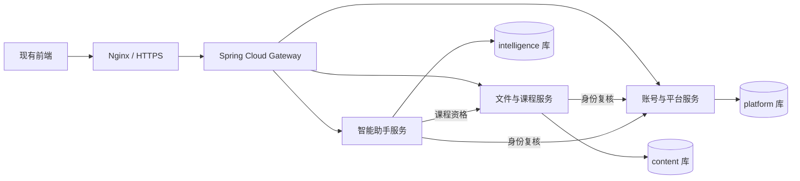

# Student Cloud · Spring Cloud 微服务架构与实施计划

方案 3.0 · 2026-10-26

本方案按用户最新要求采用 **Spring Cloud 微服务**，替代前期模块化单体的默认运行方式。新后端仍以独立实现为前提；不调用旧后端、不修改当前线上网站，前端保留现有主题和角色动画。

## 1. 当前架构

四个独立 Java 进程，15 个 Maven 子模块。业务不按每个功能按钮拆服务，也不将同一套完整后端复制四份称作微服务。

| 服务 | 端口 | 所有业务与数据 |
| --- | --- | --- |
| `cloud-platform-service` | 18101 | 初始化、账号与邮箱登录、邮箱注册/找回、空间入驻与成员管理、人工客服；`student_cloud_platform` |
| `cloud-content-service` | 18102 | 文件驱动、个人目录、授权、容量、云盘申请/本地盘审批、课程与资料；`student_cloud_content` |
| `cloud-intelligence-service` | 18103 | 长期记忆、反馈整理、审核知识、检索、任务 Outbox；`student_cloud_intelligence` |
| `cloud-gateway` | 18093 | 显式路由、发现、负载均衡、有限熔断、WebSocket 代理；不连接业务数据库 |

文件与课程在同一服务内协调资料写入、存储预算和失败补偿，避免强事务链引入分布式事务。账号与人工客服在平台内保留，减少 JVM 数量，同时明确成员隐私、账号停用和接待权限。模型和资料任务位于智能边界，未来可按负载增加独立 Worker，不把任务入库当作执行完成。

## 2. 框架与组件

| 技术 | 用途 |
| --- | --- |
| Java 21 / Spring Boot 4.1.2 | 服务运行基线 |
| Spring Cloud 2025.1.4 | 统一依赖版本 |
| Gateway Server WebFlux | 路由和流式代理，不在网关操作文件/数据库 |
| LoadBalancer / SimpleDiscoveryClient | 固定内网地址发现服务，配置多个实例时支持客户端负载均衡 |
| CircuitBreaker / Resilience4j | 授权依赖的熔断与有界超时，网关仅对有限元数据 GET 使用短超时 |
| MySQL 8.4 | 一个实例承载三个独立 schema 和数据库账号，各服务独立迁移 |
| Nginx | 前端、HTTPS 和代理 |
| Redis | 当前仅可选基础设施模板，业务缓存与跨实例通知后续接线 |

版本依据 [Spring Cloud 官方兼容表](https://spring.io/projects/spring-cloud/) 选择，不使用预览框架。阿里云 ECS 不强制 Alibaba 全家桶；两台固定服务器先使用明确的 VPC 地址，不额外启动 Nacos、Eureka、Config Server、Seata、Kafka 或消息队列。实例频繁变更后再考虑兼容版本的 Nacos/MSE。

允许正常使用成熟框架、事务及厂商 SDK，不以禁用 Spring/MyBatis/认证库证明独立。保留前端及历史代码仍遵守原许可证和来源记录，不称整个仓库为零上游代码。

## 3. 真实数据边界

每个服务只拥有自己数据库的凭据、迁移和数据表。共享 MySQL 实例用于节约资源，不能跨服务 JOIN；数据库账号实际禁止读取其它库。

`cloud-account-api` 仅提供角色、Actor 和 `AccountDirectory` / `SessionAuthenticator` 契约。内容和智能服务通过内部 HTTP 复核身份，不依赖身份持久化，不复制账号表，也不锁远端账号行。课程授权由内容服务提供，智能服务不读取课程表。

跨服务 ID 为外部引用，不设置跨库外键。内容服务自有 owner/settings guard，智能服务自有 assistant guard，用于本地数量、幂等及预算串行化。

平台服务现有5份迁移：身份、人工客服、邮箱验证码、空间入驻、注册资料。成员列表按页批量读取昵称及加入状态，避免按每名成员分别查询形成 N+1；内容服务统计不可用时明确标记未知，前端显示“—”，不将故障伪装成空空间。

## 4. 调用、安全和故障

- 内部接口要求随机 `SC_INTERNAL_KEY`，网关拒绝 `/internal/**` 并清除浏览器伪造的 `X-StudentCloud-*` 头。
- 目标服务仍验证用户会话与业务权限，服务密钥不等于用户授权。鉴权不可用返回 503，不能降级放行。
- 远程连接 1 秒、读取 2 秒、熔断限时 3 秒，调用线程和等待队列有界。4xx 业务拒绝不作为依赖故障计入熔断。
- 写入、发送消息和上传不自动网络重试；下载和 SSE 不套短元数据超时。
- 登录预算使用网关 HMAC 签名的客户端地址，后端验证时效与签名；默认忽略任意 X-Forwarded-For，只允许精确配置的前置代理覆盖真实 IP。
- 客服票据 30 秒一次性、绑定会话和明确 Origin。就绪后前端补读；通知不含正文，HTTP 读取仍鉴权。
- WebSocket 网关会先升级浏览器，再连接上游；上游拒绝票据时以 1008 关闭已经升级的连接，不把 HTTP 101 当作认证成功。

## 5. 关键业务规则

普通管理员管理本空间成员和成员容量；全局管理员负责平台与本地服务器资源审批。成员私人目录、资料和个人信息隔离。普通管理员的本地盘须经全局批准，只能分配受控目录，连接根不得互相包含或重复。

公开注册必须完成邮箱验证。空间管理员直接创建启用空间，无需审核；成员凭邀请码直接加入，凭空间名提交本空间管理员审批。公开注册不能创建全局管理员，加入空间也不自动获得私有云盘或课程访问权。管理员手工创建成员可不填邮箱，未验证的邮箱不能标记为已验证。

找回密码验证邮箱后撤销旧会话，保留账号停用及待审批状态。验证码按注册/找回用途隔离、摘要保存、限制发送/错误次数并一次性消费，SMTP 发送不长期占用业务事务。真实 QQ SMTP 尚未配置或验证，接入方法见 [邮箱注册与 QQ SMTP 配置](../backend-independent/deploy/microservices/邮箱注册与QQ-SMTP配置.md)。

普通管理员可创建课程，其它普通管理员和成员可加入。邀请码可多次创建、设置有效时间和人数上限，并可撤销。成员读取共享资料，持续上传能力由创建者批准。

“未解决”仅保存用户主动选定的问答，全局管理员核验修订、明确发布。课程来源只能发布到原课程；检索前后复核资格，通用导出不混入课程内容。人工客服由用户确认，不把所有反馈自动转人工。

公开邮件注册、找回与空间邀请/审批的业务及 SMTP 适配已接通，定向验证结果见 [邮箱注册与空间入驻实施记录](邮箱注册与空间入驻实施记录-2026-10-26.md)。真实邮件服务/ECS 投递与完整 Agent 仍待完成，不能混写为全产品已经可上线。

## 6. 文件与资源预算

LOCAL 上传私有暂存，网络读取不持 SQL 事务；提交前复核授权和目录状态，再在本地连接/授权锁内核算容量。当前采用有预算的真实目录遍历，并非常数时间账本。文件系统副作用不能自动随数据库回滚；崩溃恢复仍需继续实现。

HTTP 解析 multipart 前限制并发上传；单文件、目录深度、扫描数量、Tomcat、连接池、客服连接和通知队列有明确上限。课程资料根与可浏览根、上传临时区相互隔离。

## 7. 两台阿里云 2核4GB ECS

| 节点 | 进程 | 初始容器内存上限 |
| --- | --- | --- |
| A | Nginx 前端 | 128MiB |
| A | Gateway | 384MiB，heap 128MiB |
| A | platform | 640MiB，heap 256MiB |
| A | MySQL | 1GiB，buffer pool 512MiB |
| B | content | 1GiB，heap 384MiB |
| B | intelligence | 768MiB，heap 256MiB |
| B，可选 | Redis 基础设施 | 192MiB，maxmemory 128MiB |

为系统、页缓存、元空间、连接与网络缓冲预留空间，不把 Java heap 当作完整进程用量。两台 ECS 使用私网 IP，安全组只允许指定相邻服务；MySQL 和业务端口不对公网开放。

当前每服务一个实例，不预设三四个相同后端。增加副本前先解决共享文件位置、客服票据及跨实例通知。Gateway、platform 仍各有单点，不承诺双机高可用；ALB、多网关或托管数据库由可靠性及预算决定。

可执行的新配置见 [微服务部署说明](../backend-independent/deploy/microservices/README.md)，与旧生产配置隔离，本轮不切域名或部署到 ECS。

## 8. 构建约束与前端

各服务只扫描自身包，显式导入运行时和必要业务。Maven Enforcer 禁止依赖旧后端和退役聚合模块；内容、智能、平台服务分别禁止引入其它业务边界实现，网关禁止业务模块和 JDBC。test scope 的身份夹具不进入发布包。

开发期聚合 `cloud-server` 已退役移除，原 `backend/` 不变。前端只做必要的版本、能力和通知适配，本轮修正开发代理使 HTTP 签票与 WebSocket 保留同一浏览器 Origin。未切换当前前端代理到未完成业务的新网关。

## 9. 后续实施顺序

| 范围 | 已完成 | 后续 |
| --- | --- | --- |
| Spring Cloud | 四进程、三库、独立迁移、路由/调用/熔断/认证边界 | 镜像、完整浏览器和 ECS 验收 |
| 账号 | 初始化、登录、会话、管理创建、邮箱注册/找回、空间邀请与加入审批 | 真实 QQ SMTP 与 ECS 投递、多因素认证/邮箱修改及完整浏览器验收 |
| 云盘 | LOCAL、申请审批、个人隔离、容量与现有基础文件页面适配 | 其它协议、预览/续传/分享、分页与完整目录范围 |
| 课程 | 邀请、跨空间加入、上传审批与资料 | 崩溃上传恢复、全部页面适配 |
| 智能 | 长期记忆、反馈审核、知识范围与任务存储 | 模型/RAG、解析、向量检索与执行器 |
| 客服 | 持久化、票据、通知和注销断开 | 跨副本通知与完整浏览器重连 |
| 性能 | 有界资源与失败隔离 | 真实热点缓存、部署环境测量 |

按业务继续迁移，不再反复框架选型。没有开展压测或架构对照，不能报告性能已优于旧版。真实 MySQL 和网关检查见 [本轮实施记录](Spring-Cloud微服务实施记录-2026-10-26.md)。

本轮41项后端定向测试全部通过（AccountAdmin 5、Email 12、Public 13、Enrollment 7、MemberQuery 4），59项前端定向测试通过；临时真实 MySQL 与本地 SMTP 接收器经 Gateway 完成8组业务检查。未执行完整全站/浏览器或压测验收，未配置/验证真实 QQ SMTP，也未改动线上网站与旧数据库。详见 [注册与入驻实施记录](邮箱注册与空间入驻实施记录-2026-10-26.md)，不将定向通过解释为整个系统已经完成。

后续基础文件适配及授权输入修复完成，累计本轮52项后端定向检查和合并129项前端测试通过；最终15模块构建、经网关6组临时H2文件流程通过。详见 [文件管理实施记录](独立微服务文件管理实施记录-2026-10-26.md)，其中分别列明MySQL与H2证据、环境跳过项和剩余范围。
