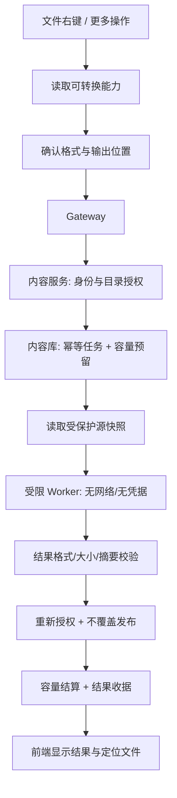

# Student Cloud 二次业务升级计划书

## 明日开发重点：右键格式转换，从“管理文件”升级为“处理资料”

| 项目 | 说明 |
| --- | --- |
| 编写日期 | 2026-10-31 |
| 计划开发日期 | **2026-11-01（明天）** |
| 文档状态 | **建议方案，待确认；不是功能完成报告** |
| 当前项目 | `C:\Users\31717\Desktop\yun\student-cloud-github` |
| 后端主线 | `backend-independent`，三个业务服务 + Gateway |
| 前端主线 | `frontend`，保留现有登录动画、灰白黑主题和小芽形象 |
| 本次交付 | 开发范围、业务规则、界面交互、技术接入位置、实施顺序和验收标准 |
| 本次不执行 | 业务代码修改、安装转换引擎、数据库迁移、服务器部署、GitHub 推送、付费模型调用 |

> **核心建议：明天优先完成“单文件 PNG/JPEG 转换”的可验证闭环。**
>
> 不以“一天支持所有格式”为目标。先做到权限正确、原文件不变、结果能保存、失败可解释，再扩展 Office、PDF 和音视频。知识库与 Agent 在这一业务能力稳定后接入同一套接口，不另外实现一条绕过权限的转换链路。

### 阅读导航

1. [先看结论与范围](#1-升级方向与范围)
2. [当前项目到底有哪些能力](#2-当前基线避免重复开发)
3. [Filee 值得参考什么](#3-filee-参考结论)
4. [右键转换怎么使用](#4-前端操作与交互设计)
5. [格式、权限、容量和异常规则](#5-转换业务规则)
6. [后端接入与任务设计](#6-后端实现方案)
7. [明天的开发顺序](#10-2026-11-01-开发安排)
8. [测试与交付标准](#11-测试与验收清单)

---

## 1. 升级方向与范围

### 1.1 产品目标

让 Student Cloud 从“上传、下载、查看文件”逐步升级为适合个人与课程使用的资料处理平台：

- **成员**：管理私人文件，按需转换格式，加入课程后使用共享资料。
- **普通管理员 / 空间管理员**：管理本空间成员、容量、云盘与自己创建的课程，同时正常存储和处理自己的资料。
- **全局管理员**：管理平台、存储资源审批、服务状态和知识质量，不代替普通管理员逐个配置成员文件权限。
- **小芽 Agent**：调用平台提供的业务工具，帮助用户查资料、整理、转换和归档；不能自行扩大权限或编造“已完成”。

### 1.2 本轮升级优先级

| 优先级 | 工作 | 为什么先做 |
| --- | --- | --- |
| P0 | 恢复可靠测试基线；明确转换权限、原件保护和资源预算 | 避免在已知失败之上继续增加写文件功能 |
| P1，明日主线 | 右键入口 + 单文件 PNG/JPEG 转换 + 私人目录保存 + 任务状态 | 功能直观，依赖少，可以完成一条真实业务链路 |
| P1，随后 | 目录服务端分页、转换历史与错误恢复、OSS/S3 能力一致性 | 减少卡顿，避免不同存储源表现混乱 |
| P2 | 详细产品知识、OSS/S3 排错说明、未解决反馈改进闭环 | 让用户能自己解决常见问题，而不是全部转人工 |
| P2 | 小芽接入转换工具、可撤销自动化策略、共享课程正文检索 | 在已有可验证工具之上增加智能化 |
| P3 | Office/PDF、WebP、有限批量、音视频；实测后接入缓存 | 依赖、资源和兼容性更复杂，不与首日强行捆绑 |

这些优先级是本计划的建议，不代表用户已经批准全部新增功能。

### 1.3 明天必须做与明确不做

**明天必须争取交付：**

- 单选一个本人可读、目标目录可写的 LOCAL 图片。
- 通过“格式转换…”打开弹窗，选择 PNG 或 JPEG。
- 展示透明背景、质量、输出位置和不覆盖原件的提示。
- 后台处理后在原授权目录生成新文件，显示结果与明确失败原因。
- 刷新页面后能查询任务；重复提交同一请求不重复生成结果。
- 完成越权、同名冲突、容量不足、格式伪装、取消及原件校验测试。

**不列为明日硬性交付：**

- 所有格式全覆盖、任意格式互转、多跳转换路线。
- 远程存储结果写回、跨云盘输出、共享课程资料自动发布。
- PDF 转可编辑 Word、扫描件 OCR、完整 Office 排版还原。
- 4K 视频转码、大批量并行、自动监听整盘。
- 自动部署或更换前端整体风格。
- 自动微调模型、未经同意将私人文件发给外部模型或转换网站。

如果安全隔离、配额预留或真实回归未完成，明天只交付**本地实验功能**，保持生产开关关闭；不能用缩减安全要求来赶“完成”。

## 2. 当前基线：避免重复开发

以下为当前源码与已有记录的核对结果，不等于本次重新运行了全部业务。

| 业务 | 当前状态 | 本轮如何处理 |
| --- | --- | --- |
| 多后端 | 平台、内容、智能三个服务，另有 Gateway；16 个 Maven 模块不等于16个运行进程 | 保留现有边界，不重新拆分成更多业务服务 |
| 身份与空间 | 邮箱/账号登录、空间管理员注册、邀请码/名称加入、成员审批已有实现 | 不重新开发登录；补齐跨功能状态提示和回归 |
| 成员密码 | 当前方向是管理员发送重置邮件、成员自行设置；旧代设接口退休 | 不恢复管理员代设密码，不借转换功能增加身份入口 |
| 文件与存储 | LOCAL；OSS/S3/MinIO 接入、读取及有限不覆盖写入 | 明日先 LOCAL；远程接入作为单独验收阶段 |
| 远程生命周期 | 远程复制、移动、重命名、删除、回收和分享仍有限制 | 转换不能暗中调用这些尚未开放的操作 |
| 容量与授权 | 成员目录授权、容量、云盘开通与本地存储审批已有实现 | 新结果必须走同一授权与容量规则；补齐转换期间的预留 |
| 文件预览 | 已有多格式私有预览；Office 为只读内容提取等有限能力 | **预览不等于格式转换**，不将预览结果冒充高保真导出 |
| 文件列表 | 已有目录分页 API，原文件页尚未整体使用服务端分页 | 后续迁移前端请求，不再假设前端全量加载能一直支撑 |
| 共享课程 | 创建、邀请、到期/人数限制、跨空间加入、持续上传资格审批已有实现 | 保持创建者审批，不因成员可读就自动允许上传转换结果 |
| RAG | 项目帮助、审核知识与个人资料词法检索已有基础 | 当前不能声称已完成向量检索或完整自动 Wiki |
| Memory | 本人明确保存的记忆、开关、相关召回及外发同意边界已有基础 | 不把聊天全部自动写入长期记忆 |
| Agent | 规则意图、受限模型规划、待确认预览、任务与结果核查已有实现 | 不是无限自主循环；新增转换工具须复用安全业务接口 |
| 反馈改进 | “没有解决”、管理员整理、润色草稿、审核发布/撤回已有实现 | 补知识内容与质量评测，不把原始反馈直接公开或训练 |
| Redis | 当前独立后端为可选基础设施模板，未完成业务缓存接线 | 不把“配置了 Redis”写成“已降低数据库压力” |

**当前已知验证欠账：**最近一次完整后端测试记录中，`WorkspaceAccountControllerTest.smtpDeliveryLetsOnlyTheMemberCompleteThePublicResetFlow` 预期 HTTP 200，实际 503；后续模块因此未完成该次全量测试。需先定位 SMTP 测试夹具、时序或投递链路原因，不能直接判断为生产故障，也不能把增加超时当成诊断。后端注释阶段的编译通过不等于这一失败已经消失。

## 3. Filee 参考结论

### 3.1 采用机制，不整体搬入桌面应用

Filee 的公开说明展示了按文件类型选择目标格式、批量进度和保留原件等体验。它是本地桌面/命令行产品；Student Cloud 是服务器上的多用户云盘，不能照搬其本机信任边界。[项目说明](https://github.com/KnifeLemon/Filee)

| 参考点 | 在 Student Cloud 中的采用方式 |
| --- | --- |
| 只提供适合当前文件的目标格式 | 后端返回能力列表，前端不靠写死的全部扩展名判断 |
| 转换引擎统一契约 | 用自有 Java 端口描述输入、输出、预算与取消，具体引擎作为适配器 |
| 原件与结果分离 | 默认在授权目录生成新文件；没有“替换原件”开关 |
| 每个文件展示结果 | 后续批量逐项成功/失败，不用一个“全部成功”遮住部分失败 |
| 引擎可用性与拒绝原因 | 未安装、格式不支持、超限、权限不足分别提示 |
| 中间文件与输出分配 | 每个任务独立临时目录、独立输出身份，只清理自己拥有的文件 |

其架构说明将转换规划、队列和具体引擎分开；本项目借鉴职责划分，不接入桌面全局鼠标监听、系统右键扩展或自动下载引擎。[架构说明](https://github.com/KnifeLemon/Filee/blob/main/docs/ARCHITECTURE.md)

### 3.2 不应照搬的功能

- 不把桌面“拖入外部链接后下载”搬到后端，避免引入任意 URL 抓取、SSRF 和认证绕过问题。
- 不采用可覆盖原件或回收原件的选项；本项目继续坚持“不覆盖已有文件”。
- 不因为上游能多线程转换，就在两台小规格 ECS 上开启大量并发。
- 不把“PDF 转 DOCX”写成无损恢复排版，不把扫描 PDF 当成现成文字。
- 不把上游格式数量作为本项目支持数量。

上游 `RoutePlanner` 按转换边规划路线，并限制多跳；本项目首版只允许白名单**直接转换**，不在明天实现通用路线搜索。[RoutePlanner 源码](https://raw.githubusercontent.com/KnifeLemon/Filee/main/src/Filee.Core/Conversion/RoutePlanner.cs)

上游 `IConverter` 描述直接转换边、引擎可用状态与输出分配等契约，可用于理解边界；本计划不直接复制其 C# 类型到 Java。[IConverter 源码](https://raw.githubusercontent.com/KnifeLemon/Filee/main/src/Filee.Core/Conversion/IConverter.cs)

### 3.3 许可与证据边界

Filee 仓库主许可证为 MIT；其引擎及附带组件仍各自适用对应许可。借用源码或分发二进制前，应核对选定版本和第三方清单、保留必要声明，不能只看主仓库的 MIT 标签。[LICENSE](https://github.com/KnifeLemon/Filee/blob/main/LICENSE)、[第三方声明](https://github.com/KnifeLemon/Filee/blob/main/THIRD-PARTY-NOTICES.md)

本次核对的是公开 `main` 文档与上述两份源码，**未下载或执行 Filee，也未固定上游提交 SHA**。GitHub API 遇到限流，`git ls-remote` 遇到 DNS 解析失败；没有因此重复安装或更改凭据。明天若实际引用代码/引擎，先记录固定版本、SHA、许可证及校验值。本次不宣称已验证 Filee 的运行效果或全部实现。

## 4. 前端操作与交互设计

### 4.1 入口

沿用当前文件列表与右键菜单，在“预览、下载”附近增加：

```text
预览
下载
格式转换…
──────────
重命名
复制
移动
删除
```

- **右击一个文件**：选择该文件后打开菜单，不把旧的多选对象带入转换。
- **右击文件夹、空白、返回上级**：不显示转换操作。
- **文件格式暂不支持**：显示禁用项及原因，而不是点击后才无解释失败。
- **没有读取权限**：不暴露转换能力和文件细节；服务端仍必须拒绝伪造请求。
- **多选**：首版提示“暂支持单个文件转换”；后续批量另行开放，不能悄悄只处理第一个文件。
- **键盘与移动端**：文件行的“更多操作”提供同一入口；支持菜单键 / Shift+F10、方向键、Enter 和 Esc。不能让右键成为唯一入口。

### 4.2 转换弹窗

```text
格式转换                                      关闭

源文件       课程封面.png       PNG · 2.4 MiB
目标格式     [ JPEG ▼ ]
图片质量     [ 85 ]             仅 JPEG 显示
透明区域     白色背景           PNG → JPEG 时显示
输出位置     当前授权目录
结果名称     课程封面.converted-<任务短码>.jpg

原文件会保留。转换结果占用你的存储额度。
文件只在本站受控环境处理，不发送给外部 AI。

                       取消       开始转换
```

首版固定输出到同一授权目录，减少跨目录、跨云盘权限组合；目录不能写时禁止提交，并说明原因。后续再增加“另选本人有写权限的目录”，不能让只读共享资料自动变成课程可上传内容。

### 4.3 任务反馈

| 状态 | 界面表现 |
| --- | --- |
| 读取能力中 | 小范围加载，源文件信息保留；不遮罩整个云盘 |
| 排队 | 显示等待和取消，不虚构预计完成时间 |
| 转换中 | 显示阶段提示；引擎没有可信百分比时使用不定进度 |
| 保存中 | 提示正在保存结果，不提前弹“转换成功” |
| 成功 | 显示“已生成 ××.jpg，原文件未修改”，提供定位结果、预览 |
| 失败 | 明确格式、容量、源文件变化、超时等原因及下一步 |
| 结果待核查 | 明确“请先核查，不要重复提交”，不当作普通失败自动重试 |
| 取消中 | 等待后台确认；不能先显示已取消、后台仍继续写入 |

关闭弹窗不等于取消后台任务。刷新页面后可从转换记录恢复查看。切换账号时清除前账号的文件、弹窗和任务状态，终止旧轮询，禁止迟到响应污染新账号页面。

### 4.4 视觉约束

- 复用当前灰白黑底色、紫色点缀、圆角、字号与 Element Plus 控件，不改登录页和小芽外观。
- 使用 `frontend/src/styles/main.css` 中的 `--cloud-*`、`--el-*` 变量，不新造一套调色板。
- 只使用短暂的菜单/弹窗反馈动效，尊重减少动态效果设置，不加入粒子、旋转环和大面积渐变。
- 390px 窄屏弹窗不溢出，长文件名可换行，错误不挤掉按钮，焦点关闭后回到原文件操作入口。
- 当前未找到根级或前端 `DESIGN.md`；正式实现时先记录现有规范与复用关系，而不是借文档之名重新设计整站。
- 本次交付可直接阅读的 Markdown 交互线框；不额外生成 Canva 海报，不把私人项目内容上传到设计服务。

## 5. 转换业务规则

### 5.1 分期格式矩阵

| 批次 | 输入 → 输出 | 适用场景 | 开放条件 |
| --- | --- | --- | --- |
| M1，明日最小版 | 静态 PNG → JPEG；JPEG/JPG → PNG | 图片兼容、课程封面、资料插图 | 有界解码、原件保护、权限/容量/保存测试通过 |
| M2 | PNG/JPEG ↔ WebP；图片 → PDF | 网页图片、图片汇总 | 固定并审查编解码依赖、颜色/透明度/方向测试通过 |
| M3 | DOCX/XLSX/PPTX → PDF；PDF → TXT/逐页图片 | 课程讲义与阅读 | 独立受限 Office/PDF 引擎、中文字体、页数和排版样本验收 |
| M4 | WAV ↔ MP3、有限 MP4 转码 | 课程音视频 | 明确 FFmpeg 构建及许可、任务时长/编码/资源预算通过 |

首版不支持 GIF/APNG 动图、SVG、TIFF、多帧图片、HEIC、RAW、压缩包、加密文档、可执行脚本及任意网页渲染。伪造扩展名不能获得支持资格。同格式压缩/缩放是后续独立功能，不冒充格式转换。

### 5.2 图片输出规则

- JPEG 质量默认 **85**，允许 **60–95**；仅接受后端枚举/数值白名单。
- PNG 转 JPEG 时透明区域固定填充白色，并在开始前告知，不默默变黑。
- 首版不提供缩放，输出尺寸应与解码后、正确方向的输入一致。
- JPEG 转 PNG 不会恢复已经损失的画质，结果也不保证更小。
- 不复制 EXIF、GPS 或其它附加元数据；方向读取后应用到像素。方向无法可靠处理或遇到不支持的色彩模式时明确拒绝，不输出方向错误的“成功”结果。
- PNG 透明度应在输出 PNG 时保留；超出首版颜色/图像能力范围时解释限制。
- 输出必须再次校验真实格式、尺寸、非空以及大小预算，不能只改后缀名。

### 5.3 权限与隐私

1. 所有转换接口必须登录；没有访客转换或匿名结果地址。
2. 按当前账号、空间、存储源、授权根、源文件和目标目录分别检查。
3. 具备源文件读取权限不等于具备目标目录上传权限；读取、提交、领取任务、保存前和读取结果时复核。
4. 成员只能在自己的授权目录输出；普通管理员可处理其合法可访问的文件，不能通过猜路径读取成员私有文件。
5. 全局管理权限不自动变成读取全体私有文件的内容权限；全局后台默认只看数量、状态、耗时和脱敏错误。
6. 撤销授权、账号停用、空间停用或目录授权变化后，任务不继续发布新结果；已产生的私有临时内容按任务归属清理。
7. 共享课程资料后续接入时，创建者的持续上传许可必须继续生效；转换到课程目录属于上传，不能绕过审批。
8. 文件转换不依赖 LLM；文件字节、路径和凭据不发送给第三方转换站或 AI。

### 5.4 原件、同名与版本

- 原文件仅用于读取，不重命名、不回收、不覆盖，不提供“替换原件”。
- 读取快照时绑定来源身份及内容指纹；源文件在准备期间变化则报 `SOURCE_CHANGED`，要求刷新。
- 输出名使用 `原名.converted-任务短码.目标扩展名`；任务短码由服务端生成。
- 发布采用原子“不覆盖创建”，不能“先判断不存在，再普通写入”。命名冲突则明确失败，不能删除同名目标。
- 任务收据记录结果的内部身份、长度、摘要；再次检查必须匹配，不能凭同名文件判断任务成功。
- 客户端断线不代表失败；重试使用原幂等键查询同一任务。
- 结果未知时保留核查记录，不对同一目标盲目重放，更不能清理不确定归属的目标文件。

远程存储阶段不能把 OSS/S3 的“不覆盖”当成所有厂商都完全相同。需按接口、Bucket 版本控制及兼容实现逐项验证；OSS 官方文档对版本控制下的相关请求头存在限制说明。[OSS PutObject](https://help.aliyun.com/zh/oss/developer-reference/putobject/)

### 5.5 容量与资源预算

以下均是**拟定初始值，尚未压测**，实现后根据样本调整：

| 项目 | 首版拟定上限 |
| --- | --- |
| 单次文件数 | 1 |
| 输入文件 | 10 MiB，即 10 × 1024 × 1024 字节 |
| 解码像素 | 1000 万像素，先读尺寸再完整解码，并限制宽高乘法溢出 |
| 输出文件 | 32 MiB |
| 同账号活动任务 | 1 |
| 全站转换队列 | 20 个；满时明确 429，不无限占用磁盘 |
| 同时运行转换 | 1 个，与 PDF 提取等重任务共用准入预算 |
| 转换执行时间 | 30 秒；排队等待另计，最多5分钟 |
| Worker 初始硬限制 | CPU 0.5 核、内存256 MiB、进程数64；需由容器/OS实际落实 |
| 单个任务临时空间 | 128 MiB；必须落实限制并验证失败清理 |
| 完成历史 | 保留7天元数据；结果文件作为用户文件保留，不随历史到期删除 |

容量按“原文件 + 新结果”计费。先预留最多32 MiB结果额度，完成后按实际结果结算，失败释放。多个请求不能各自只看“还剩32 MiB”而共同超额；预留和结算由内容库事务统一保护。

首版只允许已有受限配额的授权对象使用；无法明确预算的管理账号，在配置单次/日处理预算前不开放。配额是业务额度，临时磁盘和服务器余量是另一层限制，两者不能互相替代。

## 6. 后端实现方案

### 6.1 方案比较与建议

| 方案 | 优点 | 主要限制 | 本计划选择 |
| --- | --- | --- | --- |
| 浏览器本地转换，再上传结果 | 不消耗服务端解码 CPU，图片起步快 | 设备差异、关闭页面即中断、后续 Office 难统一，仍需上传授权 | 不作为主链路；未来可选快速模式 |
| 内容服务协调 + 受限转换 Worker | 统一任务、权限、配额和历史，后续可扩展 | 必须落实进程隔离和资源预算 | **推荐** |
| 整体部署 Filee CLI / 全部引擎 | 格式丰富，可快速试验 | 引入 .NET/引擎体积、多用户边界和资源兼容负担 | 仅作为后续独立技术验证，不直接上生产 |

保持三个业务后端，不新增常驻的第四个业务后端。Worker 是内容服务的受限执行单元，不持有数据库、用户会话、云存储凭据或内部服务密钥。

### 6.2 调用链



### 6.3 任务归属：不跨库操作

转换任务、预算预留、文件结果归内容服务所有，建议使用内容库中的 `sc_file_conversion` 及配额预留记录。

**不直接调用智能库的任务表。** 当前 `cloud-content-service/pom.xml` 明确禁止依赖 `cloud-tasks`；不能为了复用而删掉这个架构约束。首版在内容服务中实现小型、专用的转换状态机。后续确需抽取通用任务契约时另立 ADR，不能顺手打通跨服务数据库。

| 拟定状态 | 含义 |
| --- | --- |
| `QUEUED` | 已创建并预留预算，等待领取 |
| `RUNNING` | 正在读源或转换，尚未发布 |
| `PUBLISHING` | 已生成有效结果，正在执行受控发布 |
| `SUCCEEDED` | 发布身份和收据一致、容量结算完成 |
| `FAILED` | 确定失败；没有未核查的发布副作用 |
| `CANCELLED` | 确定没有发布，进程和私有临时内容已处理 |
| `RESULT_UNCERTAIN` | 发布或结算结果不明，阻止自动重试，等待核查 |

工作进程通过数据库条件更新领取任务；持有租约和代次标识。租约只能防止旧进程提交任务状态，不能单独阻止旧进程写文件；仍须结合发布前复核、唯一输出和不覆盖原子操作。重启后不能直接重放 `PUBLISHING`，应先核对收据及输出身份。

### 6.4 拟定接口契约

以下均为**新接口建议，当前尚不存在**。沿用已有 `/api/drives/**` 网关路由即可，不必新增宽泛代理。

| 方法与路径 | 作用 |
| --- | --- |
| `GET /api/drives/{key}/conversions/capabilities?path=...` | 经授权后返回格式、限制、可用性与原因；不启动转换 |
| `POST /api/drives/{key}/conversions` | 幂等创建本人转换任务，返回 HTTP 202 和任务ID |
| `GET /api/drives/{key}/conversions/{jobId}` | 本人任务状态、阶段、错误和获准查看的结果信息 |
| `GET /api/drives/{key}/conversions?limit=20&cursor=...` | 本人在当前存储源的转换记录；有界游标查询 |
| `POST /api/drives/{key}/conversions/{jobId}/cancel` | 请求取消，返回后台实际确认的状态 |

创建请求拟包含：`sourcePath`、`sourceRevision`、`targetFormat`、`quality`、`idempotencyKey`。首版目标目录固定为源目录；不接收本机路径、输出绝对路径、命令参数或引擎下载URL。

错误码建议：`UNSUPPORTED_FORMAT`、`READ_DENIED`、`WRITE_DENIED`、`SOURCE_CHANGED`、`QUOTA_EXCEEDED`、`CONVERSION_BUSY`、`ENGINE_UNAVAILABLE`、`CONVERSION_TIMEOUT`、`TARGET_EXISTS`、`RESULT_UNCERTAIN`。对无权知道的文件和任务返回一致的不可访问响应，不能通过错误差异枚举他人文件。

### 6.5 执行隔离

- 首版图片引擎采用 Java 21 ImageIO 可用的 PNG/JPEG 编解码；显式禁用或定向管理磁盘缓存。
- 转换不在 HTTP 线程和内容服务主 JVM 里解码整个文件。
- Worker 只看到单个只读输入与单个任务输出目录；不挂载整个云盘、项目根目录或私有配置。
- 生产隔离应具备非 root、只读根文件系统、禁网、无额外能力、进程/内存/CPU/临时空间限制；应用不得获得 Docker socket。
- 由部署侧预置受限 Worker，或配置等效 OS 约束；不能让普通用户指定可执行程序和参数。
- 本地子 JVM 的 `-Xmx`、超时和环境变量清理只是开发防护，不等同于完整安全沙箱。未落实生产隔离时不对公网开放。
- 不自动安装引擎；引擎升级先固定版本、校验、许可和回归，再人工发布。

## 7. 结合现有业务的后续升级

### 7.1 文件与存储

1. **目录分页接入前端**：复用现有分页 API，检索/排序在服务端完成，导航取消旧请求，保留当前位置，不再整盘加载。
2. **能力统一**：每个存储源明确支持浏览、上传、转换输入、结果写回等，禁用项附原因。
3. **添加存储向导**：先选用途和类型，再填必要字段；区别“字段检查通过”“只读探针通过”“写入/回读/清理通过”。
4. **连接故障诊断**：按网络/TLS、endpoint-region-bucket、凭据、目录权限、读写权限、清理失败区分；不把密钥带入错误日志。
5. **远程转换**：先受控下载到任务快照，转换后用同一授权、`writeVerified` 和不覆盖能力写回。远程结果不明进入核查，不全局重试。
6. **容量账本**：区分个人额度、课程额度、临时预算、回收站占用和实际磁盘；不画没有采集来源的“真实磁盘增长图”。

### 7.2 课程与审批

- 加入课程、下载资料、持续上传权、单次资料发布分别显示状态。
- 普通管理员加入其他人课程后也是受该课程规则约束的参与者，不能因为自己有管理员角色就越过创建者审批。
- 转换共享资料时，默认结果保存在本人目录；发布回课程必须有持续上传资格，且不得跨空间泄漏源资料。
- 退出、移除、课程停用后阻止新的资料读取、检索与转换；不自动删除已经合法下载到用户本机的副本，也不承诺可远程撤回这些副本。
- 邀请码继续支持长期/到期/人数限制/手工撤销；并发达到人数上限时原子判定，不重复开发已有基础功能。

### 7.3 管理后台

- 全局后台聚焦待审批本地存储、资源预算、失败率、队列积压、知识反馈，不重复普通管理员的日常成员授权页面。
- 普通管理员优先看到待办：成员加入、云盘开通、课程上传资格，以及相关容量情况。
- 图表必须标注时间、统计口径和数据是否完整；“未知”显示 `—`，不能当作0或正常。
- 转换管理仅展示聚合数量/耗时/错误类别；不默认暴露成员完整文件名、路径、内容或个人问答。
- 审批、额度修改、发布/撤回知识保留操作者、时间、前后状态；业务汇总不冒充完整审计记录。

## 8. 知识库与 Agent 后续计划

### 8.1 详细知识库

先修正和扩充当前真实功能说明，再考虑向量或 Wiki。每条知识至少包含：

> 适用角色与范围 → 前置条件 → 操作入口 → 具体步骤 → 成功现象 → 常见失败 → 排查顺序 → 隐私与数据影响 → 源码/接口依据 → 版本与核对日期。

首批主题：账号注册登录、空间加入、成员授权和容量、LOCAL 审批、OSS/S3/MinIO 连接与排错、上传续传、下载预览、格式转换、回收与分享、课程邀请和上传审批、小芽任务与记忆、反馈与人工服务。

特别补齐转换说明：支持格式、PNG透明背景、JPEG有损、结果变大、文件变化、额度不足、排队/超时/取消、原件保留、远程写回限制。不能把未上线的格式写进“操作指南”。

### 8.2 隔离与来源

- 产品公共说明可以共享；个人记忆、私有资料按用户隔离。
- 空间知识按空间资格过滤，课程知识按当前课程资格过滤，不能仅按 `USER` 角色过滤。
- 检索前过滤和返回前复核同时保留；撤权不能只等索引或缓存自然到期。
- 上下文发给外部模型前明确取得本轮同意，最小化片段；密钥、密码和完整文件默认不进入提示词。
- Wiki 页面绑定原始来源与版本，源文件更新/删除/撤权使派生内容失效；不能把私人资料整理后转成全站知识。
- 自动评测先覆盖隔离、引用、工具参数和失败恢复；真实模型质量评测与合成接口测试分开记录。

### 8.3 小芽转换工具

后续示例：“把这张封面转成 JPG，保存到当前目录。”

1. 小芽询问或使用用户明确选中的文件，不搜索全盘猜文件。
2. 查询后端能力，解释损失、输出位置和容量。
3. 展示计划；用户确认后创建同一个转换任务。
4. 查询任务状态，只有拿到可核对的结果收据才回答完成。
5. 转换失败时说明原因和下一步；参数缺失先澄清，不动辄转人工。

初期仍需确认写操作。后续“自动执行”必须有用户主动建立的范围、类型、额度、有效期与撤销规则，不能把一次同意升级成永久任意写入。

工具调用由模型建议、应用实际执行；格式正确不等于已授权或已成功。[DeepSeek Tool Calls](https://api-docs.deepseek.com/guides/tool_calls/)

### 8.4 回答格式和反馈改进

- 默认回答先给结论，再给最多3–5个必要步骤；长说明由用户展开。
- 任务回答统一：“做了什么 / 保存在哪里 / 是否有失败”，不输出大段自我介绍。
- 引用应支持结论，覆盖不足就明确说“不确定”，不伪造文档和成功结果。
- “没有解决”进入后台待处理队列；管理员回复整理 → AI可选润色草稿 → 检查隐私与来源 → 人工审核 → 发布新知识 → 回归原问题。
- 原始反馈不直接共享、导出或用于训练；周期性微调仅作为有授权样本、预算和留出评测后的可选评审项。

## 9. 性能与两台 ECS 资源策略

### 9.1 不以增加后端数量代替优化

继续采用既定布局：A 节点放入口、平台与 MySQL；B 节点放内容、智能和受限转换执行单元。首版只运行一个内容写入实例和一个转换 Worker。

不为了格式转换引入 Nacos、Kafka、Seata、分库分表或再加3–4个业务实例。当前共享本地文件、任务副作用、客服票据等状态尚未满足任意复制条件；两台机器也不是自动高可用集群。

### 9.2 延迟优化顺序

1. 先采集浏览器路由切换、API耗时、数据库次数、慢 SQL、文件 I/O、模型耗时及队列长度。
2. 优先处理串行重复请求、目录全量加载、过大前端包、无截止时间和请求竞争。
3. 转换、PDF提取等 CPU/内存重任务共用准入预算，排队代替压满CPU；队列满时明确限流。
4. 热点确认后再加入 Caffeine/Redis，不缓存文件正文和完整模型上下文。
5. 可先缓存产品帮助、非敏感字典和管理汇总；键包含范围与版本，更新主动失效，私有内容不走共享无范围键。
6. 鉴权/撤权不依赖长 TTL；缓存故障时不能绕过权限，降级请求也须有上限，避免数据库被回源打满。

Redis 客户端缓存也需要失效机制，不能靠“放进缓存”自动保证新鲜性。[Redis 缓存与失效说明](https://redis.io/docs/latest/develop/clients/client-side-caching/)

### 9.3 Nginx 与下载

转换走任务接口，不保持一个长 HTTP 请求直到完成。文件下载与聊天流分别配置，不盲目统一关闭所有缓冲。Nginx 开关影响磁盘、内存和上下游传输，应依据路由测试选择。[Nginx proxy buffering](https://nginx.org/en/docs/http/ngx_http_proxy_module.html#proxy_buffering)

后续下载优化单独评测鉴权流式传输、Range 与远程对象读取，不通过开公网对象地址或无限多线程换取测速数字。

### 9.4 拟定衡量方式

在相同机器、相同资料、相同网络和相同权限条件下记录：页面可操作时间、元数据API p50/p95、数据库查询次数、下载吞吐、转换成功率/排队时间/耗时、CPU/RSS/临时磁盘峰值。

建议以10个并发元数据用户叠加1个转换任务作为首轮小规模负载，测试窗口10分钟；比较有无转换时的 p95 和错误率。暂以元数据 p95 增幅不超过20%作为待校准门槛；若原基线已不可用，应先修基线而非满足相对值。这里没有宣称已达标或性能优于其它云盘。

## 10. 2026-11-01 开发安排

> **约8小时的时间盒，不是无条件完工承诺。** P0未通过不开始发布功能；安全项做不完就保持开关关闭。其余二次升级按第12节分期，不塞进同一天。

| 顺序 | 建议时间盒 | 任务 | 当段交付 |
| --- | --- | --- | --- |
| 1 | 09:00–10:00 | 固定当前工作状态，定位SMTP失败，运行有关回归，确认无关改动不被覆盖 | 失败原因、基线结果与未解决项 |
| 2 | 10:00–11:30 | 确认转换契约；先写权限/预算/幂等/状态机失败用例，再实现任务创建与查询 | 本人任务、配额预留、可用性接口 |
| 3 | 11:30–12:00 | 新增右键和“更多操作”入口，绑定明确的单个文件 | 不误处理旧选择；无权限和不支持状态 |
| 4 | 13:30–15:00 | 完成PNG/JPEG受限执行、输出验证与不覆盖保存 | 一张合成图片的端到端成功闭环 |
| 5 | 15:00–16:00 | 转换弹窗、任务轮询/取消、结果定位、窄屏与键盘 | 成功/失败/未知状态完整 |
| 6 | 16:00–17:00 | 运行安全/故障回归、原件哈希核对、整理交付记录 | 可演示最小版或明确的未完成阻断项 |

### 10.1 任务 DYX-001：可靠基线

**目标**：确认当前失败与现有修复的真实状态，不拿旧报告代替新结果。

**文件**：平台测试 `WorkspaceAccountControllerTest.java`、`LocalSmtpServer.java`；已有工作流脚本。

- [ ] 保存当前差异清单，不回退或混入已有功能改动。
- [ ] 定向复现SMTP预期200实际503的用例，观察实际失败来源；先定位，再最小修复。
- [ ] 运行相关模块测试；后续完整测试单独报告通过、失败、跳过。
- [ ] 记录明确的初始文件、身份夹具、输入、输出和版本。

**验收**：有可复现的基线和失败结论；没有未解释的同链路失败。

### 10.2 任务 DYX-002：内容服务转换边界

**依赖**：DYX-001；第5节业务规则被确认。

**目标**：后端拒绝不合法转换，即使前端菜单被绕过也不影响隐私和文件。

- [ ] 先写失败测试：匿名、他人任务、同空间他人文件、只读目录、格式不支持、超预算、重复幂等键。
- [ ] 增加转换能力、创建、查询、列表、取消接口，全部从当前身份推导归属。
- [ ] 在内容库新增版本化迁移，不修改已应用的旧迁移；下一版本号由执行时最新迁移确定。
- [ ] 实现内容侧任务状态、预算预留、事务领取和输出收据，不引入智能库任务依赖。
- [ ] 验证重启、重复领取、撤权、过期和发布未知状态不发生自动重复写入。

**验收**：任务身份可核验，原子预留不超额，源与目标授权均由服务端决定。

### 10.3 任务 DYX-003：安全图片转换

**依赖**：DYX-002。

- [ ] 先写失败测试：伪扩展名、损坏图片、超像素、透明PNG、JPEG方向、超时、命名冲突。
- [ ] 用固定PNG/JPEG引擎完成受限转换；格式由内容检查而非仅后缀判断。
- [ ] 为每个任务建立独立只读输入快照及私有输出；执行单元没有网络和密钥。
- [ ] 校验输出格式、尺寸、长度与摘要，重新授权后原子不覆盖发布，按实际长度结算。
- [ ] 核对取消、失败和进程退出后的临时内容清理，保留需要核查的发布记录。

**验收**：生成真实可解码目标文件，原件哈希不变，失败不删除任何非本任务文件。

### 10.4 任务 DYX-004：前端操作闭环

**依赖**：DYX-002的接口；成功链路验收依赖DYX-003。

- [ ] 先写选择与交互测试，固定右击对象、当前账号和请求代次。
- [ ] 复用现有菜单与弹窗控件，增加第4节入口和表单；不整体改版。
- [ ] 只显示后端允许的目标格式，解释有损、透明背景与额度。
- [ ] 展示排队/转换/保存/完成/失败/待核查；关闭弹窗不取消任务。
- [ ] 轮询只在可见任务区域进行，初始2秒、有界退避到10秒，终态、卸载和身份切换停止。
- [ ] 在真实浏览器验证键盘、390px、长文件名、登录失效和迟到响应。

**验收**：能从文件进入、创建、查看和定位结果；不会把取消请求误报成已取消或把旧账号结果显示给新账号。

### 10.5 任务 DYX-005：收尾与交接

- [ ] 按第11节逐条记录结果，标注未运行/受环境限制，不能写为通过。
- [ ] 记录支持格式、资源上限、错误码、迁移和生产开关。
- [ ] 产品知识只在功能已验收后增加真实操作说明；未完成格式继续标为计划。
- [ ] 不部署、不推送；交由用户本地试用后再确定下一批。

**下一步动作**：确认本计划范围后，从DYX-001开始，不先安装所有格式转换引擎。

## 11. 测试与验收清单

### 11.1 必测场景

| 编号 | 场景 | 预期结果 |
| --- | --- | --- |
| C01 | PNG转JPEG、JPEG转PNG | 文件真实格式与后缀一致，可解码，尺寸正确 |
| C02 | 透明PNG转JPEG | 白底且事前提示，无黑底/透明误导 |
| C03 | 带方向及GPS元数据图片 | 方向正确；输出不保留GPS/EXIF，不支持时明确拒绝 |
| C04 | 同名目标已存在 | 不覆盖、不删除；结果冲突明确 |
| C05 | 同一幂等键重复/并发提交 | 相同请求同一任务；不同参数冲突，不重复占额度 |
| C06 | 两个任务竞争最后额度 | 只在原子预算允许范围内受理，不超配额 |
| C07 | 任务提交后撤销授权/停用账号 | 不继续发布结果，不泄露源内容 |
| C08 | 同角色不同用户、同空间不同成员 | 不能查询任务、猜路径或读取结果 |
| C09 | 其它空间管理员/全局管理员尝试读取个人内容 | 没有明确内容授权就拒绝，不因管理角色放行 |
| C10 | `.jpg`实际是HTML/脚本、损坏/超像素图片 | 拒绝，不执行内容，不耗尽主服务内存 |
| C11 | 超时、进程崩溃、磁盘不足 | 有界失败，释放确认可释放的预算和临时内容 |
| C12 | 排队/运行取消，保存期间取消 | 状态真实；保存不明不误标已取消、不盲删目标 |
| C13 | 发布后结算前进程退出 | 进入可核查状态，重启不重复转换/写入 |
| C14 | Worker输出越界、软链接、伪装格式 | 不发布，不触及任务目录之外的文件 |
| C15 | 原文件在快照准备时修改/替换 | 检测来源变化，拒绝混合或错误版本 |
| C16 | 刷新、切换目录、切换账号、网络断开 | 可恢复本人任务；不重复提交、不串账号 |
| C17 | 右键空白/目录/多选，更多菜单与键盘 | 不选错文件，禁用原因明确，操作不只支持鼠标 |
| C18 | 390px、长中文文件名、减少动效 | 无横向溢出、焦点丢失和强制动画 |
| C19 | 转换期间正常浏览/下载/聊天 | 主业务仍可用，记录CPU/RSS/延迟而非主观说快 |
| C20 | 功能开关关闭或引擎缺失 | 返回明确能力不可用，不形成假入口或后台持续重试 |

### 11.2 命令与测试层级

执行人员需在对应目录运行，使用本机已安装的 Java21、Maven 和 pnpm；缓存目录按实际环境设置，不复制秘密配置。

```powershell
# 后端目录：C:\Users\31717\Desktop\yun\student-cloud-github\backend-independent
# 内容服务及依赖回归；随后再运行全工程verify。
mvn -pl cloud-content-service -am test
mvn verify

# 前端目录：C:\Users\31717\Desktop\yun\student-cloud-github\frontend
pnpm test:unit
pnpm typecheck
pnpm build
```

新增测试类建议：`FileConversionServiceTest`、`FileConversionControllerTest`、`ImageConversionProcessTest`；前端建议 `file-conversion.test.mjs`、`file-conversion-runtime.test.mjs`。名称为拟定，尚未创建。

至少分别记录：单元/协议测试、真实MySQL接口联调、真实浏览器交互、受限Worker执行、资源负载。模拟引擎通过不能证明真实格式转换通过；H2不能代替全部MySQL并发与迁移测试。

### 11.3 完成判定

明日最小版只有同时满足以下条件才可标“完成”：

- [ ] LOCAL 单图转换成功，原件哈希不变，结果有收据且确实出现在授权目录。
- [ ] 关键隔离、原件保护、容量、幂等、取消和未知结果测试全部通过。
- [ ] 新增迁移在空库和已有开发库各验证一次，不破坏旧数据结构。
- [ ] 没有新增未解释的相关测试失败；全量未通过则明确列出，不宣称项目全完成。
- [ ] 界面成功、失败、无权限、缺引擎、窄屏和键盘场景均验证。
- [ ] 生产开关、限制和未覆盖项写清；隔离未达标则保持生产关闭。

## 12. 明天之后的阶段安排

| 阶段 | 交付重点 | 进入下一阶段的条件 |
| --- | --- | --- |
| 第一阶段 | 明日最小转换闭环及当前回归欠账 | 第11节完成；未完项如实延续 |
| 第二阶段 | 目录分页、历史/核查、OSS/S3转换写回、真实厂商验收 | 远程权限、条件写入、清理及异常核查通过 |
| 第三阶段 | 详细知识库、OSS/S3排错、反馈回归与角色隔离 | 内容有来源/版本，跨用户/课程与撤权测试通过 |
| 第四阶段 | 小芽调用转换工具、有限自动化、共享课程正文索引 | 同一权限链路可复用，工具结果可核验 |
| 第五阶段 | WebP/Office/PDF，按实测加入缓存 | 引擎质量、许可证、资源和失效策略验证 |
| 可选探索 | 音视频、批量、Wiki、向量嵌入、微调资格评估 | 证明真实需求与收益，有预算与隐私授权 |

不把后续阶段承诺为明天全部完成。每阶段保持可运行、可回退、可测试；不在功能尚未稳定时切换线上网站。

## 13. 预计代码接入位置

下列路径均相对于文首仓库根目录。`现有`代表已核对，`拟新增`代表计划，不得据此声称已经创建。

| 路径 | 状态 | 职责 |
| --- | --- | --- |
| `frontend/src/components/file/ZContextmenu.vue` | 现有，修改 | 右键入口与可用性说明 |
| `frontend/src/composables/file/useFileContextMenu.js` | 现有，修改 | 绑定右击文件，避免空白与旧选择混用 |
| `frontend/src/pages/file.vue` | 现有，少量修改 | 挂载转换弹窗与结果定位，复用列表刷新 |
| `frontend/src/components/file/FileConversionDialog.vue` | 拟新增 | 表单、状态、取消与结果操作 |
| `frontend/src/composables/file/useFileConversion.ts` | 拟新增 | 能力/任务请求、轮询、身份代次与取消清理 |
| `frontend/src/api/home/file-conversion.ts` | 拟新增 | 与现有HTTP客户端兼容的转换API封装 |
| `backend-independent/cloud-content-service/src/main/java/io/studentcloud/content/http/FileConversionController.java` | 拟新增 | 参数校验与当前身份适配，不直接启动任意进程 |
| `backend-independent/cloud-content-service/src/main/java/io/studentcloud/content/conversion/FileConversionService.java` | 拟新增 | 授权、任务、预算、受控发布协调 |
| `backend-independent/cloud-content-service/src/main/java/io/studentcloud/content/conversion/ConversionJobRepository.java` | 拟新增 | 内容库任务、租约、代次与收据 |
| `backend-independent/cloud-content-service/src/main/java/io/studentcloud/content/conversion/ConversionEngine.java` | 拟新增 | 固定格式、资源与取消的自有执行端口 |
| `backend-independent/cloud-content-service/src/main/java/io/studentcloud/content/conversion/ImageConversionProcess.java` | 拟新增 | 有界PNG/JPEG执行适配，不接受用户命令 |
| `backend-independent/cloud-content-service/src/main/java/io/studentcloud/content/config/ContentMigrations.java` | 现有，修改 | 注册新的内容库迁移 |
| `backend-independent/cloud-drive-application/src/main/java/io/studentcloud/drive/application/MountService.java` | 现有，按需扩展 | 复用目录授权、不覆盖上传与额度入口 |
| `backend-independent/cloud-content-service/src/main/java/io/studentcloud/content/remote/RemoteDriveService.java` | 现有，后续阶段 | 远程权限、读写能力与结果核查 |
| `backend-independent/cloud-intelligence-service/src/main/resources/ai/knowledge/project-help.json` | 现有，后续阶段 | 经验证的格式转换知识条目 |
| `backend-independent/cloud-intelligence-service/src/main/java/io/studentcloud/intelligence/agent/AgentModelPlanner.java` | 现有，后续阶段 | 受限转换计划建议，不能绕过确认和内容服务 |

实现前再检查同名文件与最新契约，优先复用既有类型；这些建议不授权顺手重构所有模块。具体端口签名和SQL迁移在各阶段实现计划里锁定，不在业务计划中伪造已经存在的接口。

## 14. 风险与应对

| 风险 | 应对 |
| --- | --- |
| 小服务器被转码拖慢 | 首日只图片、全站1并发、硬资源限制、重任务统一准入 |
| 转换结果覆盖或删除原件 | 不提供替换，唯一结果身份 + 原子不覆盖 + 原件哈希回归 |
| 权限只在提交时校验 | 领取、读取、保存、结果访问均复核，撤权走明确失败 |
| 转换解码器处理恶意文件 | 白名单、内容检查、尺寸预算、无密钥/禁网受限执行与版本维护 |
| 源/结果变化导致误报成功 | 快照指纹、结果身份和收据，不凭文件名推测 |
| 私人课程或文件泄漏 | 内容授权不随管理角色放大；Wiki/反馈/日志按来源最小化 |
| 任务重启重复发布 | 幂等、租约代次、发布收据；未知状态先核查，不盲重试 |
| Office/PDF输出质量不足 | 单独做字体/公式/复杂排版样本；清楚标注能力，不承诺无损 |
| 借鉴开源后来源不清 | 固定版本与许可证，保留必要声明；独立业务设计不靠删除署名证明 |
| 一天范围过大 | 以M1验收为界；后续功能明确延期，不以假入口代替完成 |

## 15. 计划核对记录与最终建议

本计划依据当前独立后端说明、实际控制器/服务/迁移、前端文件菜单与样式，以及 Filee 的上述公开资料形成。源码分析只说明设计与实现位置，不能替代运行验证。曾安排并行只读审查，但子任务因额度限制未产出完整报告；最终由主代理完成范围、依赖和风险自查，不宣称已经通过独立评审。

交付前自查重点：

- 明天日期明确为2026-11-01，不把历史版本号当新发布版本。
- 保留当前三个业务服务，不把转换任务放进智能服务数据库。
- 明日M1与后续格式、知识库、Agent、性能优化分开。
- 每个阶段有具体输入、结果与失败验收，未实现内容均标为建议。
- 本次仅新增计划文档，不改源码、不部署、不使用真实私人文件或付费API。

**最终建议：先把一张图片真正、安全地转换成功，再扩展格式；先让业务工具可靠，再让小芽自动调用。**

> 明天第一个动作：复现并定位SMTP回归失败，固定基线；随后按DYX-002至DYX-005实现首版右键转换。若你确认本计划，即以此作为下一轮开发清单；本次不自动开始实施。
