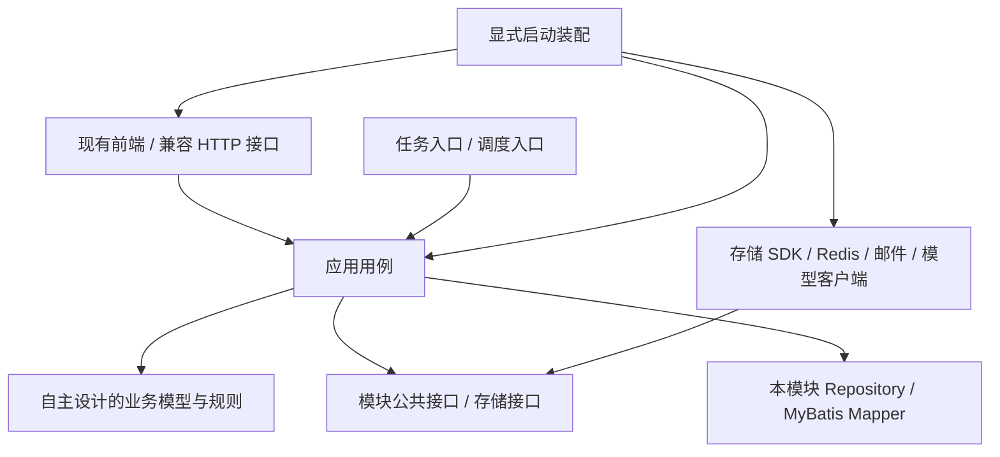
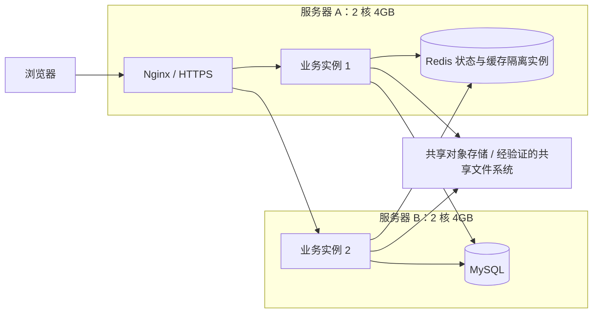

# Student Cloud 后端独立架构重写计划书

> **历史方案说明（2026-10-26）：用户最新要求已改为 Spring Cloud 微服务。本文方案 2.4 的单体默认部署决策已被 [Spring Cloud 微服务架构与实施计划](Spring-Cloud微服务架构与实施计划.md) 替代。** 本文保留为过程记录；当前工程、组件、服务拆分和最新状态以新计划及实施记录为准。

> 版本：方案 2.4 · 更新日期：2026-10-26
>
> 现状：已完成源码边界审计。本文件是实施计划，不表示独立后端或双机部署已经完成。
>
> 工作范围：在当前仓库重新建设独立后端；保留现有前端主题、页面和角色动画，通过接口适配连接新后端。用户已允许必要的前端调整，不借此重做整个界面。暂不操作线上网站。

## 1. 方案结论

目标是建设自主设计、独立实现的 Student Cloud 云盘后端。以账号、工作空间、个人文件、共享课程、Agent 和知识库等业务需求为起点，重新设计工程结构、数据模型、权限规则和存储服务，不继续在 ZFile 的后端骨架上改造。

采用**按业务划分的模块化 Spring Boot 架构，结合明确的模块接口、可替换的存储提供者、持久化任务及按需拆分的 Worker**。允许正常使用 Spring MVC、MyBatis/MyBatis-Plus、Sa-Token、Spring 事务、Redis、通用 SDK，以及适用的 Spring Cloud 组件。使用这些通用框架不影响项目属于自主设计；不要求为证明独立而手写框架、密码学或所有基础设施。

方案不强制纯 JDK 领域层，也不把所有业务拆成大量技术层模块。独立性的判断是**工程与业务实现不依赖 ZFile 代码**；结构优劣以模块职责、依赖清晰度、业务正确性、维护成本及实测性能判断。不能预先保证某种架构在所有场景下最优。

用户最新确定：使用人数不多，有两台服务器，允许业务拆分，要求停止反复架构选型验证并直接实施。因此本次确定 **Spring Boot MVC 业务模块化 + 可独立运行的有界异步任务 + MySQL + Redis/Caffeine + Nginx**。模块按账号、空间、云盘、课程、助手分开；部署保持在线业务与耗时任务两类，不为每个模块启动一个进程。事件可靠记录优先使用数据库 Outbox，读写用例分离但暂不拆两套数据库。

两台服务器后续分别承接在线入口/业务与任务/基础服务，资源按部署实况分配。本地现在不做 Spring Cloud/Dubbo/Kafka 等架构对照试验、不启动压测，仅做实现所必需的编译和功能检查。下文双实例、微服务及压测是保留的后续演进说明，不是当前必做项；也不以未执行的测试宣称性能提升。

充分利用服务器是让资源有效服务请求，不是让所有 CPU/内存始终满载。独立工程先实现真实业务，Spring Cloud、Dubbo 不作为当前必需依赖，未来确需跨服务治理时可接入。

先在当前仓库完成可独立运行的模块化后端，再实测选择部署方式。两台服务器均为 **2 核 CPU、4GB 内存**；优先验证的部署候选为 **Nginx + 两个业务实例 + Redis + MySQL + 共享文件存储**，每台一个业务实例。如果单业务实例加独立 Worker 的延迟和稳定吞吐更好，则采用该方案。暂不默认运行三个或四个完整业务实例。

Spring Cloud 可以引入，但应解决实际服务拆分问题。初期由 Nginx 承担入口与负载均衡；需要单独扩容解析、索引和 Agent 任务时，再引入独立 Worker，并按需要使用 Spring Cloud Gateway、Circuit Breaker 等组件。不能通过增加框架或进程数证明性能更好。

**完成目标：后端运行实现独立，现有前端继续使用，核心业务不丢失，性能通过同条件对照验证。**

## 2. “独立”和“性能更好”的定义

### 2.1 后端独立

最终必须同时满足：

1. 新后端拥有独立 POM、配置、启动入口和迁移起点，不编译、不加载旧后端也能构建、测试和启动。
2. 文件列表、上传、下载、分享、审批、课程、Agent 等实际请求全部进入新实现。
3. 新存储驱动不继承 `AbstractBaseFileService`，不访问 `StorageSourceContext`，不读取静态当前用户或分享上下文。
4. 不复制、继承、委托或扫描旧控制器、授权服务、驱动和初始化器作为新后端的实现；仅换包名、拆目录或包装接口不算独立。
5. 最终运行 JAR 不包含已退役的旧实现；兼容层仅转换协议与数据，不调用旧实现。
6. 全部承诺保留的功能与协议完成独立实现和验证。仅重写 LOCAL，或者用新接口包装旧服务，不算完成。

新工程不复制旧 Entity、Mapper、用户服务和存储基类作为起步模板。现有项目中已独立扩展的课程、Agent 等业务也按新需求和模型审查、重新实现；契约与测试场景可作为行为参考，但不能把旧实现整包搬入新工程。

保留现有前端意味着前端仍可能包含原有授权代码，因此不能把整个仓库称为“零上游代码”。历史许可证、版权和来源记录保留；历史资料与当前运行实现分别管理。使用 Spring Boot、MyBatis、Sa-Token、数据库或存储厂商 SDK 等通用依赖，不等同于依赖 ZFile。

### 2.2 性能目标

比较对象首先固定为当前项目继承版本，基线提交为 `fbb1610`。不能以该对比声称胜过所有版本的官方 ZFile。若以后要明确对比某个官方版本，须另行固定其版本、配置及共同功能，再进行独立测试。

性能验收必须同时给出：p50/p95/p99 延迟、吞吐、错误率、CPU、进程总内存、数据库查询次数、连接池占用、缓存命中率及任务排队时间。

以下为**待实测的目标，不是现有成绩**：

| 场景 | 改进目标 | 对照要求 |
| --- | --- | --- |
| 文件列表、空间成员及课程列表 | 优先使主要慢接口 p95 降低至少 20%；已很快的接口控制回退 | 相同页大小、权限及数据分布，分别测冷缓存和热缓存 |
| 管理总览 | 聚合查询和短时缓存减少数据库读取，消除随列表长度增长的逐项查询 | 记录 SQL 次数和结果时效，不以返回旧数据冒充提速 |
| 同等延迟下的吞吐 | 在 CPU/数据库确为可扩展瓶颈的场景争取提高至少 20% | 重写比较先固定单实例、相同拓扑与资源；扩容收益单独测试 |
| 上传、下载 | 保持流式与有界内存，避免文件大小增长导致等比例堆内存增长 | 分别测小文件、大文件、慢客户端及 Range 下载 |
| 文件与课程并发写入 | 配额、最后一个邀请码名额和重复任务执行不出错 | 正确性必须先通过，不能降低校验换性能 |
| 资源占用 | 同等负载下保留合理内存与 CPU 余量 | 统计全部进程及基础服务，不只计算 Java 堆 |

若目标未达到，保留结果并分析瓶颈，继续调整；不以修改测试口径宣布成功。架构独立、功能正确、性能达标分别验收。

## 3. 当前后端的审计基线

2026-10-25 对当前生产 Java 源码统计如下。行数包含注释和空行，只表示改造规模，不表示质量或原创比例。

| 范围 | 文件数 | 行数 |
| --- | ---: | ---: |
| 全部生产 Java | 582 | 63,455 |
| 存储模块 | 191 | 23,273 |
| `core` 公共模块 | 111 | 12,475 |
| 用户模块 | 54 | 4,504 |

共找到 224 个方法级 HTTP 映射注解；这是注解数量，尚需整理成去重后的路由契约清单。

主要继承耦合：

- 27 个文件引用 `StorageSourceContext`，涉及注册、查找、初始化和销毁。
- 31 个文件引用 `AbstractBaseFileService`，现有驱动基类同时承担生命周期、用户目录和会话读取。
- 32 个文件引用 `TlgxyCloudAuthUtil`，后台任务与请求调用存在隐式身份依赖。
- `StorageDriverRegistry` 仍返回旧驱动基类，目前只是边界包装，不是独立存储 SPI。
- `StorageSourceInitializer` 启动时寻找全部旧驱动；只新增实现并不能使旧实现退出运行。
- 用户、系统配置、初始化、分享、直短链、密码规则、SSO、OnlyOffice 等也属于审计和替换范围。

证据入口：[现有分层记录](后端架构重构-20261021.md)、`AbstractBaseFileService`、`StorageSourceContext`、`StorageSourceInitializer`、`DirectoryListingApplicationService` 及 `BackendModuleBoundaryTest`。

## 4. 新架构：按业务模块组织，合理使用成熟框架

选择模块化 Spring Boot 后端，模块内可采用 Controller、Service、Repository/Mapper、Provider 等常见结构。它们是通用工程方法，不是某个云盘项目专属架构。Student Cloud 自行定义业务边界、依赖方向、数据模型与执行流程，不沿用旧项目的工程骨架。

模块内允许使用 `@Service`、`@Transactional`、Bean Validation、MyBatis 实体及 Mapper，也允许使用 Sa-Token 完成认证。复杂授权规则、路径规范化和状态转换应便于独立测试，但不强制把所有模型做成纯 JDK 类型。



实际工程约束：

- 按账号、空间、文件、课程、助手等业务拆模块，各模块拥有自己的规则与数据访问，不重复搭建多套技术框架。
- Service 可直接使用本模块 Mapper 和 Spring 事务；跨模块通过明确的公共服务接口交互，不直接访问对方 Mapper 或随意修改对方数据。
- 持久化 Entity 可用于模块内部，HTTP 使用显式请求和响应 DTO，避免密码、密钥及内部字段随实体序列化泄露；不要求为每个简单对象机械建立多套模型。
- 存储提供者处理协议能力，用户、空间、授权、配额由业务服务决定；驱动不自行从请求线程猜测访问者。
- Controller 负责参数、身份入口、调用用例及响应映射，耗时文件 IO 和多步骤业务集中在可测试的服务中。
- 允许在新工程明确的包范围内自动组件扫描；禁止扫描旧后端，启动测试核对实际 Bean、路由、过滤器和任务。
- Maven 依赖和架构测试禁止循环依赖及旧实现引用；框架使用合理性由性能和维护成本判断，不以零框架依赖为目标。

## 5. 后端模块规划

目标采用以业务为中心的 Maven 多模块，初期打成一个业务服务运行包。编译模块不等于独立微服务；小模块可先以受约束业务包实现，确认边界后再分 Maven 子模块，避免为数量而拆分。

| 模块 | 自主设计的职责 | 可使用的框架与边界 |
| --- | --- | --- |
| `cloud-common` | 必要的错误码、ID、分页、校验和基础契约 | 可使用通用库，不成为堆放业务逻辑的大杂烩 |
| `cloud-account` | 邮箱/账号登录、注册、密码、会话与撤销 | Spring MVC、Sa-Token、MyBatis、SMTP；对外提供账号公共接口 |
| `cloud-workspace` | 空间、成员关系、加入申请、管理员职责和审批 | Spring Service/事务、本模块 Mapper；通过契约与文件模块协作 |
| `cloud-drive` | 存储连接、文件操作、目录授权、配额、续传、分享和链接 | MyBatis、Redis、自有 Provider 接口、NIO及厂商 SDK |
| `cloud-course` | 课程、独立成员关系、邀请码与上传审批 | Spring Service/事务、本模块 Mapper；不直接读取私人云盘表 |
| `cloud-assistant` | 资料检索、索引、记忆、任务状态、知识整理与发布 | 模型/embedding 客户端、文档解析、Redis和任务仓储 |
| `cloud-platform` | 全局配置、初始化、业务统计、审计和人工客服 | Spring MVC/WebSocket、MyBatis、缓存；按内部业务包继续隔离 |
| `cloud-server` | 启动、模块装配、配置绑定、健康检查、兼容 HTTP 入口 | Spring Boot；不积累业务规则 |
| `cloud-tests` | API、数据导入、权限、产物与性能验证 | JUnit及隔离基础设施；不进入生产运行包 |

在当前仓库的独立开发目录（建议 `backend-independent/`）建立全新后端工程，不从旧 `backend/` 继承 POM 或复制业务源码。旧后端保留只读对照，新后端通过独立端口和合成测试库验证；完成后再调整为正式 `backend/` 入口，前端不重建架构。开发目录名称可调整，不能改变独立构建及零旧实现调用的验收要求。

优先使用构造器注入与模块公共契约解决依赖，确有跨模块原子业务时设计协调用例；不要依靠循环注入、静态全局容器或把所有接口放入 common 规避边界。后续独立 Worker 复用任务契约和成熟框架，不复制整套业务服务。

## 6. 身份、权限和隐私

### 6.1 显式访问上下文

请求入口解析登录身份，应用层接收不可变的访问上下文，例如账号 ID、空间 ID、会话撤销版本、操作 ID 和请求来源。角色和授权必须由可信服务端数据确定，不能相信请求中的角色字段。

后台任务记录发起人、目标资源和授权条件，执行前重新获取有效身份与授权，不能复制请求线程中的上下文当作长期权限。

### 6.2 保留当前业务规则

- 成员：本人获批的个人目录、本人索引与记忆，以及已加入课程。
- 普通管理员：本空间成员、成员密码重置、云盘申请、目录范围和容量；创建课程并批准参与者上传。
- 全局管理员：站点与跨空间治理、本地存储审批、客服和知识维护；不提供成员日常权限编辑。
- 普通管理员可以使用自己的文件空间，也可以加入其他管理员创建的课程。
- 课程成员关系独立于原空间；加入课程不获得对方空间私人目录权限。
- 本地存储必须经过全局审批；普通管理员不能通过构造参数接管服务器任意目录。
- 全局最高常规权限仍受目录密码、隐藏策略、源停用等既有保护规则约束。

鉴权策略形成独立可测试的决策模型。缓存负责加速读取，不成为授予权限的来源。密码验证使用成熟密码学实现，兼容已有哈希格式；旧格式升级必须在正确验证后进行，不能要求无依据地批量重置密码。

## 7. 独立文件内核与存储驱动

### 7.1 新存储接口

独立定义列表、分页、元数据、受限字节流读取、上传、目录创建、复制、移动、重命名、删除及连接探针。统一路径和值对象，统一超时、取消、失败类型和能力声明。

驱动返回业务中立结果，不返回 Spring `ResponseEntity`、数据库实体或旧 `FileItemResult`。HTTP 层再映射为现有前端需要的格式。

接口必须明确：虚拟路径与物理路径、用户根与存储根、覆盖策略、符号链接策略、分页游标归属、大小是否可信，以及是否支持条件写入、目录操作、版本回收和容量计量。不能靠继承一个大基类假定所有协议拥有相同能力。

### 7.2 替换顺序

1. LOCAL：独立 NIO 文件内核、受限根路径、有界递归、流式读写和安全发布。
2. S3 兼容：基于通用 SDK 重新实现列表、分页、签名、条件写入和版本化清理。
3. WebDAV、SFTP、FTP：按同一驱动契约实现，分别验证协议差异。
4. 其余现有存储类型：逐项完成认证、令牌刷新、读写及错误处理的独立适配。

不把剩余驱动静默删除来宣称独立。如果某个外部服务缺少测试账号，标记“实现完成、外部验收待完成”，不能当作通过。所有保留功能完成替换后，才能宣布全部后端独立。

### 7.3 安全和一致性

- 路径规范化只做一次，拒绝穿越、越根、非法名称和不受允许的符号链接。
- 校验文件系统实际路径，不能只检查字符串前缀；Linux 单列符号链接测试。
- 新文件先写受控暂存区，校验大小/内容后再发布，失败只清理本操作拥有的临时文件。
- 明确覆盖和冲突语义，上传失败不能留下半个最终文件；移动/复制不默认覆盖。
- 支持时使用条件操作；不支持的跨介质原子操作以可恢复任务执行，不伪称事务原子性。
- 数据库与文件系统不能由普通 SQL 事务一起回滚，使用操作记录、状态核对与补偿处理。
- 配额采用预留、提交、释放流程，拒绝并发超额；已有使用量需要初始化核对和定期校准。
- 连接测试区分只读检查与用户明确确认的写入/读回/清理，报告每一步结果。

## 8. 高效数据访问与 Redis

优先处理实际慢查询、N+1 查询、重复身份检查和没有边界的列表，之后再决定缓存粒度。

| 数据 | 主要策略 |
| --- | --- |
| 目录展示元数据 | 按源、路径及版本缓存；分页后仅为当前页补充链接 |
| 管理总览 | 有界聚合、明确 TTL、失效通知；未知统计不能显示成零 |
| 成员与课程列表 | 数据库分页、匹配过滤字段的索引，避免逐行补查 |
| 登录会话与撤销信息 | 多实例共享，修改密码、禁用账号后撤销旧会话 |
| 验证码与短期票据 | 有期限、一次性校验、共享限流，不在日志输出内容 |
| 权限和分享 | 使用实时策略与撤销版本；敏感操作执行前复验 |
| 长期记忆和知识正文 | MySQL 持久保存，按账号/空间隔离，Redis 不作为唯一副本 |

缓存键不直接包含秘密；命中率、回源次数和失效失败可观察。防止同一热点到期造成集中回源，跨实例失效使用明确版本机制。权限缓存须有严格撤销语义，不能只依赖几十秒 TTL。

状态 Redis 与可丢弃元数据缓存默认使用两个独立实例，分别预算内存；仅靠 DB 编号或 namespace 不能隔离淘汰策略。状态实例使用 `noeviction`，写入失败和撤销状态无法核实时拒绝敏感访问；缓存实例允许明确的回源策略，故障不能绕过权限。

状态实例拟启用 AOF `everysec`，正常条件下仍可能丢失最近约一秒写入，系统或磁盘异常还可能扩大窗口，因此持久化不等于绝不丢数据。密码变更、禁用与撤销版本以数据库为准，恢复 Redis 旧快照不能使已撤销令牌重新生效。一次性业务操作由数据库唯一消费记录保证；短期连接票据在状态恢复后统一失效。业务任务和客服历史仍以数据库为准。这些恢复语义必须经过故障测试后才允许双实例部署。

## 9. Agent、RAG 与异步任务

重新实现任务应用服务，使用数据库保存状态、幂等键、执行步骤、租约与重试信息，降低进程重启造成的状态丢失。

```text
创建方案 → 待确认 → 确认并复验 → 排队 → 领取租约 → 执行步骤 → 核对结果 → 完成/失败/人工处理
```

关键约束：

- 确认绑定方案版本、发起人及目标，确认后发生变化时要求重新确认。
- 两个实例不能同时执行同一任务；租约过期后的旧执行者不能继续提交结果。
- 不承诺网络系统天然“恰好执行一次”：通过持久化记录、幂等效果和结果核对防止重复副作用。
- 读取、可幂等操作和不可安全重放的写操作采用不同重试策略。
- 解析、OCR、embedding、模型请求和文件 IO 使用独立有界资源预算，不占满 HTTP 工作线程或数据库连接。
- 定时规则在多实例中只能生成一个对应任务，不用每实例独立定时器重复执行。
- 资料索引继续校验当前权限、文件指纹及内容覆盖范围；共享课程与私人索引不自动混合。
- “未解决”进入管理员整理队列；人工纠正、AI 润色、范围审核与发布分开，不自动转人工或自动训练模型。
- 长期记忆按账号隔离，可编辑、停用和删除；不能因架构迁移扩大外部模型可读取范围。

客服会话与消息持久化。WebSocket 票据、撤销校验和跨实例通知共享；通知丢失后可通过数据库消息游标补读，不能依赖 Pub/Sub 永不丢消息。

## 10. 两台 2 核 4GB 服务器的部署判断

### 10.1 优先验证的候选：两个业务实例



MySQL 和 Redis 只走同地域 VPC 私网，入口仅开放必要端口。Nginx 根据实测采用轮询或 `least_conn`；连接治理、超时、流式转发和实例退出摘流配套设计，不能自动重试可能产生副作用的请求。

建议初始资源预算如下，均须按真实工作集调整：

| 服务器 | 服务 | 初始容器上限建议 |
| --- | --- | --- |
| A | Nginx | 128 MiB |
| A | 业务实例 1 | 1024 MiB，Java 堆先限制在约 512 MiB |
| A | Redis 状态实例 | 192 MiB，内部数据预算低于容器上限 |
| A | Redis 元数据缓存实例 | 128 MiB，内部数据预算低于容器上限 |
| B | 业务实例 2 | 1024 MiB，Java 堆先限制在约 512 MiB |
| B | MySQL | 768–1024 MiB，连接池及 buffer pool 按实测配置 |

其余内存为操作系统、页缓存、容器运行时、原生内存及突发请求保留。上限不是实际占用保证，也不能全部分配为堆内存。两个实例的数据库连接总数必须统一预算，解析/OCR 并发先从全局 1 开始验证。

### 10.2 双实例前必须解决的状态

| 问题 | 必需方案 |
| --- | --- |
| 登录漂移 | 共享会话与撤销校验；不能靠黏性会话掩盖问题 |
| LOCAL 文件只在一台机器 | 选择共享存储，或明确单文件服务所有者并设计受鉴权内部访问；不能把两块本地盘当成同一个目录 |
| 续传分片分散 | 会话与分片位置统一，完成/取消幂等，跨节点请求可定位同一份分片 |
| 课程文件与索引位置 | 使用统一文件标识与可访问的存储，不保存不可跨节点读取的临时绝对路径 |
| Agent 和定时任务重复 | 数据库幂等记录、租约及旧执行者隔离 |
| 客服跨节点 | 共享票据、跨实例通知及历史补读 |
| 共享配额 | 数据库原子预留与最终校准，不能使用进程内计数 |

优先复用已有 OSS/S3 等可共享存储。若课程及获批 LOCAL 必须保留 POSIX 文件语义，应评估同 VPC NAS 的成本、权限和延迟；不能擅自购买或把普通同步脚本当作强一致共享盘。共享方案未就绪时，先保留单业务入口，把第二台用于有界任务处理，不提前启用不安全的双实例写入。

P8 放行前必须选定 NAS 或单所有者文件服务等具体方案，并证明上传、续传、课程和索引指向同一持久对象。验证主机失联、网络分区时哪些操作拒绝、如何恢复核对，以及锁、条件写入和原子重命名的真实保证；不能因两台机器具有同名挂载路径就判定共享正确。

### 10.3 为什么不默认三个或四个业务实例

增加 JVM 会重复消耗堆外内存、连接池和线程，两个 CPU 核心还需与数据库、TLS 和文件操作竞争。若瓶颈在 MySQL、磁盘、网络或模型供应商，多开 API 实例不能解决它。

完成双实例后，只有实测存在空闲资源、吞吐持续改善且错误率不升高，才试验三个或四个实例；总数据库连接数和全局任务并发不能随实例数线性膨胀。选择以稳定完成请求的效率为准，不以实例数量为目标。

此方案仍有入口、单 MySQL 与单 Redis 等单点，**不是完整高可用集群**。后续高可用需额外的入口、数据库和状态服务方案，不能用“两台服务器”直接宣称完成。

## 11. Spring Cloud 的使用时机

用户已确认可考虑 Spring Cloud。其定位是服务拆分后的治理能力，而非后端独立或性能提升的判定标准。[官方项目说明](https://spring.io/projects/spring-cloud/)列出配置、服务发现、路由、负载均衡与熔断等能力。

| 组件/能力 | 本方案选择 |
| --- | --- |
| Gateway | 独立服务数量和路由治理确有需要时引入；初期不与 Nginx 重复增加一跳 |
| Circuit Breaker | 外部模型、解析 Worker 等故障隔离确有需要时启用；不自动重放文件写入 |
| 服务发现/配置中心 | 两台固定节点先用受控配置和私网地址；不默认再部署一套集群 |
| 服务调用 | 使用类型明确、带超时和取消的内部契约，不直接共享数据库实体 |
| 消息中间件 | 初期用数据库 Outbox 与任务记录；有吞吐/隔离证据后再评估专用队列 |

八类候选架构在当前小规模双机部署中的取舍：

| 架构 | 当前决定 |
| --- | --- |
| 分布式集群/负载均衡 | 保留 Nginx，先完成共享状态与文件定位；当前不先启动三四个业务副本 |
| 微服务/Spring Cloud/Dubbo | 按业务模块拆分，在线与任务可分进程；暂不部署完整治理组件 |
| 事件驱动 | 采用有界异步任务与数据库 Outbox，不先引入 Kafka/RocketMQ 集群 |
| 响应式 | 采用 Spring MVC 的流式/异步能力，远程IO有超时；不整体改 WebFlux，也不在响应式线程中执行阻塞 JDBC |
| 多级缓存 | Redis 与受限本地缓存用于适合的数据，明确失效和撤销策略 |
| 数据库读写分离 | 暂不引入主从，先做好索引、分页和聚合 |
| 分库分表 | 暂不使用，小规模业务不增加分片路由与跨分片事务复杂度 |
| CQRS | 读写用例与DTO分离；不先创建独立读库或事件溯源系统 |

若独立拆分 Worker，优先迁移 OCR、文档解析、embedding 等重任务，核心文件变更和权限决策留在明确的业务边界。主应用与 Worker 通过版本化任务契约交互，Worker 不自行跳过授权读取任意用户文件。

旧后端基线为 Spring Boot 3.3.2；独立工程开发 POM 当前使用 Spring Boot 3.5.16 与 JDK 21，并不表示该组合已经完成生产支持及依赖安全验收。以后采用 Spring Cloud 时须遵循[官方兼容矩阵](https://spring.io/projects/spring-cloud/#overview)，不能直接叠加任意最新版；发布前确认支持状态及 MyBatis、Sa-Token、Flyway、数据库和文档解析依赖的兼容性。框架升级与业务重写分开提交，便于定位回退原因。

## 12. 前端和数据兼容

以现有 `frontend/` 和原有主题、角色动画为界面基线。用户于 2026-10-26 明确允许必要的前端调整，因此可以修改请求适配、分页/版本字段、状态展示及独立后端所需交互；不将此解释为授权重做整个界面或删除既有业务。迁移前记录前端文件哈希，保留每次接口差异及变更范围；新后端优先通过兼容适配器保留路径、方法、成功码、错误码、分页、SSE 事件和 WebSocket 行为。

不能通过隐藏按钮或重做页面来掩盖缺失接口。确实无法原样保持的安全错误语义、新增版本条件或异步状态，形成明确差异记录并同时调整调用方；前端展示与真实服务能力一致，不能无说明改变或返回假成功。

新后端使用独立数据库、自己设计的表和新的迁移起点，不继续以旧 V1–V80 表结构作为开发骨架。禁止新工程启动时自动连接或修改现有业务库；旧库、原文件和旧迁移保持原样。

如需保留旧数据，通过单独、显式执行的只读导入器迁移至新库，记录账号ID、空间、存储授权、课程、知识、记忆、客服和文件标识的映射；不通过运行时调用旧服务维持兼容。导入流程必须可重复核对、检测冲突和报告未迁移项。

脱敏合成数据库演练至少覆盖：新库初始化、重复启动、旧数据导入、重复导入、失败中断、关系完整性、权限等效与文件内容校验。旧下载链接、签名与会话是否延续须单独设计，不能因保留API路径就宣称旧令牌自动兼容。回退保留旧库不变，新系统产生的数据另行处理，不能只切旧镜像就宣称可回滚。

## 13. 实施阶段与放行标准

阶段必须串行放行，驱动与测试等不冲突工作可并行。每阶段交付源码、测试、依赖清单及未完成项，不用总代码行数表示进度。

| 阶段 | 主要交付 | 放行条件 |
| --- | --- | --- |
| P0：基线与契约 | 路由/功能矩阵、数据字典、前端哈希、性能脚本、依赖图 | 能复现旧版本功能与性能基线 |
| P1：独立工程骨架 | 独立POM/入口/配置、新业务模块、自有数据模型及新库迁移 | 不编译或加载旧后端即可构建启动；允许正常使用Spring/MyBatis/Sa-Token |
| P2：身份与授权 | 独立登录编排、会话适配、空间/目录/课程决策 | 登录兼容、跨空间拒绝、密码变更撤销及隐私测试通过 |
| P3：LOCAL 文件内核 | 新驱动、上传下载、分页、续传、配额与连接探针 | 实际 LOCAL 请求进入新实现；Linux 文件边界及故障恢复通过 |
| P4：其它存储与链接 | S3及其余协议、OAuth刷新、分享、直短链和预览 | 驱动共同契约、权限撤销与各协议验收清单完成 |
| P5：协作与平台 | 成员审批、课程邀请上传、配置、初始化、统计审计 | 既有业务全部接入新仓储/用例，邀请码与配额并发正确 |
| P6：助手与客服 | 检索、记忆、任务租约、知识发布、会话和通知 | 重启/重复确认/跨节点事件等测试通过，无旧实现调用 |
| P7：退出旧实现 | 清除旧运行依赖、扫描规则、构建与产物整理 | 真实启动和最终 JAR 均无旧活动实现，兼容层只做映射 |
| P8：性能与双机演练 | 同条件对照、故障注入、双实例状态与资源报告 | 正确性全部通过，性能目标达标或明确继续整改；仍不自动上线 |

新后端按业务需求实现，旧项目仅作为接口行为、可选导入数据与性能对照。读接口在合成环境比较结果；写接口只写合成文件和新库，禁止对真实文件双写。独立后端验证完成前，旧项目与线上环境保持原样。

## 14. 测试与性能验证方法

1. 单元测试：领域规则、路径、授权、任务状态转换和失败分支。
2. 驱动契约：每种协议执行同一组能力测试，不支持项明确声明。
3. 真实 HTTP：覆盖现有前端所用全部接口及错误行为。
4. 基础设施：隔离 MySQL、Redis、Linux 文件系统与真实运行装配。
5. 并发：固定屏障竞争配额、邀请最后名额、任务确认、知识发布及权限撤销。
6. 故障：数据库/Redis断连、进程退出、磁盘不足、远程超时、部分复制失败与通知丢失。
7. 流式：SSE 首事件、取消与错误；WebSocket 重连与补读；上传慢客户端和下载 Range。
8. 产物：检查 Maven 依赖、字节码引用、Spring Bean 原始类、HandlerMapping、Servlet/Filter、监听器和定时任务。

压测使用相同镜像基础、数据库数据、文件样本、CPU/内存约束和网络位置。至少覆盖 100、1000、10000 项目录及不同成员规模；从 10、30、60 并发逐级推进，每级预热后持续采样，关键组重复至少三次。到达资源边界即记录饱和点，不用失控压测损坏环境。

性能报告分成两部分：第一部分固定旧版单实例与新版单实例的拓扑、资源和数据，衡量重写收益；第二部分比较新版 1/2 个实例及必要时 3/4 个实例，分别给出相同总资源与实际部署资源下的扩容曲线。旧版尚不支持安全双活，不能用黏性会话或不一致的旧双活环境制造对照结果；也允许“单实例 + Worker”在实测中成为最终方案。

分开测试冷缓存、热缓存、混合读写、文件传输和模型调用。模型首字受供应商延迟影响，需同时记录本站排队、检索与网络耗时；不能把模型响应延迟全部算成后端架构问题。

记录网络耗时与后端处理耗时，区分数据库等待、CPU、GC、连接池和存储 IO 瓶颈。数据库查询用实际执行次数及执行计划验证；架构重写不应为追求“零数据库查询”而牺牲权限正确性。

## 15. 最终完成清单

- [ ] 所有现有业务与接口有迁移归属，未遗漏边缘协议和回调。
- [ ] 新工程可独立构建启动，不引用、复制、继承、委托或扫描旧业务实现；框架及本模块Mapper可正常使用。
- [ ] 所有业务入口实际调用新实现，而非仅增加未使用的接口。
- [ ] 旧 Bean、控制器、过滤器、监听器、定时任务和驱动不再注册。
- [ ] 最终 JAR 不携带退役旧实现，来源清单与历史许可可追踪。
- [ ] 前端主题、页面、角色动画和主要交互保持，必要的接口调整有记录，兼容契约通过。
- [ ] 新库初始化、可选旧数据导入、重复导入、数据关联与文件内容验证通过，旧库未被覆盖。
- [ ] 三角色权限、私人目录、课程范围、审批和密码撤销通过。
- [ ] 全部保留存储驱动完成替换，外部环境待测项没有冒充通过。
- [ ] 多实例会话、任务、配额、续传、文件位置和客服通知一致。
- [ ] 同条件性能对照报告可复现，目标达标；未达标项继续整改。
- [ ] 双机演练和降级边界明确，服务器资源有余量。

在这些条件未满足前，只报告完成的阶段，不能将项目描述为“后端完全独立”或“性能已优于对照版本”。

## 16. 本次计划的交付与边界

本计划书交付不代表代码重写已完成。用户已授权在计划完成后开始本地实施，先整理契约和既有结构，再在独立目录建立新工程。当前按用户要求不开展架构对照或压测，不把尚未执行的 P0 性能基线写成已验收。实施期间允许必要的前端接口与交互适配，但不连接服务器、不变更线上数据库、不自动推送或部署；进度以源码、构建及后续实际执行结果记录。

最终交付应包含独立后端源码、接口契约、模块依赖图、数据迁移说明、驱动能力表、测试与压测脚本、同条件对照报告、双机部署及回退手册。目标优势通过这些产物证明，而不是通过隐藏项目来源、换包名或增加微服务数量来表示。

## 17. 本地实施记录（2026-10-26）

独立工程位于 `backend-independent/`，拥有自己的 POM、`io.studentcloud` 启动入口、数据库配置及 V1–V8 自有迁移。当前为 `0.1.0-SNAPSHOT` 开发版本，原 `backend/` 不作为它的构建依赖或运行回退。下表记录代码范围，不表示对应阶段已全部放行。

| 范围 | 已落地代码 | 尚未完成的关键部分 |
| --- | --- | --- |
| 账号与空间 | 初始化、邮箱/账号登录、摘要会话、撤销、空间管理员和本空间成员管理 | 公开邮箱注册、SMTP 验证、找回密码、空间公开加入流程 |
| LOCAL 云盘 | 独立路径与 NIO 内核、显式授权、个人目录、成员云盘申请、本地盘全局审批 | 其余协议、续传、完整文件夹范围授权、连接探针与分享链接 |
| 容量控制 | 增长操作在连接/授权行锁内核算真实目录，上传先私有暂存并复验；超预算扫描拒绝 | 高效用量账本、故障恢复、跨节点真实共享目录验收；当前并非常数时间计量 |
| 课程 | 跨空间课程、多个独立邀请、过期/人数限制、上传审批、私有资料及预算状态 | 崩溃后遗留上传的自动恢复、完整前端联调 |
| 助手与知识 | 账号记忆、反馈分页/备注/审核版本校验、空间/课程/全站发布与撤回、课程资格复核、有界关键词检索 | 模型问答、AI 润色、语义向量检索、资料解析与 Agent 执行器 |
| 人工服务 | 幂等申请与消息、接待、申请者关闭、HTTP 历史游标、一次性连接票据、WebSocket 就绪补读与通知 | Redis 跨实例广播、完整浏览器重连验收 |
| 任务 | 幂等任务、租约、fence、取消、重试及创建 Outbox | 业务处理器、调度、跨进程通知与副作用恢复 |
| 缓存与部署 | 明确模块边界及独立配置 | Redis/Caffeine 接线、双机运行、资源与性能实测 |

当前默认仅监听本机 `127.0.0.1:18093`，使用独立 H2 内存库；MySQL profile 只接受明确的新独立库名。可浏览云盘及私有课程目录分别由显式配置提供，不能相互包含；旧秘密配置和旧数据库不会自动读入。

截至本记录，最新 9 个子模块已跳过测试完成编译打包。隔离 H2 实例已成功启动并执行 V1–V8 迁移，账号、私有记忆、课程反馈发布、本地盘审批/容量及客服 HTTP/WebSocket 的基本检查通过；临时实例已停止。前端 3 个文件做了版本字段、能力提示及客服就绪补读适配，主题、页面布局与角色动画保持。详情见 [独立后端实施记录](独立后端实施记录-2026-10-26.md)。

**Maven 测试源码未执行，真实 MySQL、完整浏览器联调及双机部署尚未验收，线上未修改。** 因此不能报告“全部独立完成”“双机已就绪”或“性能已优于旧版”。
