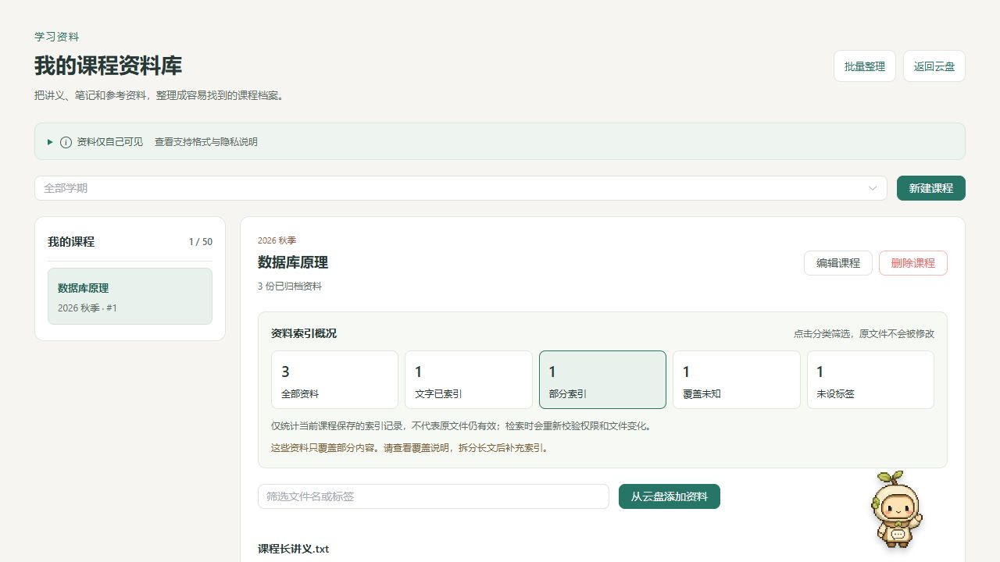

# 学习资料与 Agent 优化记录

日期：2026-10-16。此次围绕学习资料管理、可确认自动化和部署可靠性扩展现有项目，不替换基础框架、不修改小芽形象、不操作用户真实数据库或云盘。

## 1. 差异化方向与本轮结果

基础文件浏览、下载和多存储接入继续复用原有工程；扩展重点是学生如何把文件变成可检索、可整理的课程资料，而不是简单改名称或删除开源署名。

| 问题 | 本轮实现 | 证据与边界 |
| --- | --- | --- |
| 哪些课程资料只索引了一部分？ | 新增课程索引概况：全部、文字已索引、部分索引、覆盖未知、未设标签；与文件名/标签筛选组合，一键清除 | `LearningIndexOverview.vue`、`learning-index-overview.mjs`；统计当前课程已保存记录，不把它当作实时文件健康检查 |
| 资料维护是否会增加数据库压力？ | 分类与组合筛选只使用已加载资料，不额外请求；切换课程重置筛选，空筛选和空资料有不同提示 | 原有列表接口不变，没有新增自动轮询或批量重新索引 |
| 上传后为何还看不到文件？ | 实际上传成功即发布原账号、存储源、目录的变更事件；关闭窗口后完成也更新；180ms 合并同目录事件 | 失败/取消/旧账号晚回调不报告成功；加载或文件操作忙碌时延后，切换账号/路由及卸载取消待刷新 |
| Agent 很快执行完成为何不刷新？ | 支持同任务从 `PENDING` 直接返回 `SUCCEEDED/PARTIAL` 时发布变更；逐目录去重 | 历史卡片首次挂载、不同任务、无成功文件操作不触发；不绕过确认执行流程 |
| 大对象存储目录会不会被 Agent 全量扫描？ | 对原生分页驱动，工具调用最多读取 400 个原始 provider 项、最多 4 次 provider 调用；递归搜索共享预算 | 不签名下载 URL、不调用全量列表兜底；非原生驱动仍可能全量枚举，响应明确 `ioBounded=false` |
| 部署检查为何失败？ | 修复业务成功码与 HTTP 状态混淆、缺少 Ajax 标记、用 GET 测试写入路由等问题 | 真实认证必须为 HTTP 401 + 业务码 `42000`；不能把 500/404/HTML/缺少 code 当成认证正常 |

本轮未逐一比较上游项目的所有发行版本，不宣称这些能力是所有云盘产品中独有。可核验的是本仓库新增的学习场景和自动化行为；原 MIT 与第三方许可继续保留。

## 2. 课程资料索引概况

入口：登录后访问 `/learning`，选择课程。

- “文字已索引”只说明已有可提取文字记录，不保证图片文字也被识别。
- “部分索引”提示查看覆盖范围、拆分长文补充；“覆盖未知”提示检查旧版或空索引。
- 缺少版本、覆盖字符、截断标记等信息时，不再显示成完整覆盖；零字符索引提示检查内容。
- “未设标签”不等于不可检索。筛选不修改资料、不触发模型、不自动产生 embedding 费用。
- 原文件变化、撤权或目录保护仍在实际检索时重新验证；仅看概况不能替代访问授权。

## 3. Agent 原生分页的真实性约束

原先工具先调用完整 `fileList`，再将结果截到 60/400 项，对大型 S3 目录并没有减少底层枚举和签名工作。

现在通过 `DirectoryMetadataProvider.nativeDirectoryPage` 读取元数据。`NativePage.rawItemCount` 计入被过滤的目录占位符等原始项，避免返回项少但实际扫描超预算。

读取前后检查授权根目录、目录密码和过滤规则；递归搜索绑定首次授权。provider 失败、异常页和重复游标立即停止，不暗中改为全量读取。

结果包含 `complete / scope / scannedItems / observedCount / providerRequests / sortScope`。未读完时 `total=null`；统计、最大文件、最近文件仅代表已扫描子集。未命中时明确“不能据此判断文件不存在”，不制造全目录结论。

不支持原生分页的驱动仍使用原有枚举接口，并返回 `LEGACY_FULL_ENUMERATION` 说明；返回数量上限不是远程 I/O 上限。

## 4. 部署检查与依赖安全

已查看 [2026-10-14 GitHub Actions](https://github.com/le5676922-max/student-cloud/actions/runs/38501068905)：后端、MySQL、Redis 作业成功；Docker 四服务构建并健康启动后，验收脚本将业务码字符串 `"0"` 与数字 `200` 比较导致失败；前端作业在依赖审计步骤失败。

本轮修正 `scripts/deployment-smoke.mjs`：

- 区分 HTTP 状态与 `AjaxJson` 业务码，校验安装状态和注册配置结构；新站 `installed=false`、邮件未配置都是合法状态。
- JSON 探针带 `axios-request: true`，避免被当作普通页面访问而重定向。
- 只使用真实 GET 处理器，不以 GET 冒充上传 PUT/POST；不假定用户的动态直链前缀必须为 `/d`。
- 认证探针必须收到 HTTP 401 和 `42000`。错误页、服务故障、错误业务码及匿名成功都使检查失败。
- 导入脚本不发请求；所有探针均为不带凭据的 GET，不初始化、不创建账号、不上传删除文件。

生产依赖修复：Vue 运行时/编译器等统一为 `3.5.42`，source-map-js 为 `1.2.2`；开发期 Handlebars 使用兼容补丁 `4.7.10`。未降低审计门槛或忽略漏洞。Vue 新编译器还暴露了原说明编辑弹窗的常量 `v-model`，已改为跟随父级状态的可写模型并覆盖取消/保存行为。

参考：[Vue reviewed 公告](https://github.com/advisories/GHSA-g2v6-rqmx-r4w6)、[Vue 修复源码](https://github.com/vuejs/core/blob/v3.5.42/packages/shared/src/domAttrConfig.ts)、[source-map-js 公告](https://github.com/advisories/GHSA-68fv-2mgg-jv7q)、[Handlebars 发布](https://github.com/handlebars-lang/handlebars.js/releases/tag/v4.7.10)。

全量审计仍有 **2 条开发依赖告警**：braces 的 high、postcss-selector-parser 6.x 的 moderate。检查时审计建议的 braces 3.0.4 无法从 npm 解析，未填写不存在的版本；selector-parser 的修复涉及大版本，不强制替换旧插件依赖。它们不在生产依赖审计图中，但不能宣称全量审计为零。见 [braces 公告](https://github.com/advisories/GHSA-vfj7-8cjw-p6xm) 与 [selector-parser 公告](https://github.com/advisories/GHSA-rj75-hqrm-r3gf)。

## 5. 实际验证与未覆盖范围

| 验证 | 结果 |
| --- | --- |
| 前端全部 Node 回归 | 501/501 通过，0 失败、0 跳过 |
| Agent / 上传 / 刷新专项 | 真实 Vue SFC、composable 和页面 setup 执行，覆盖即时终态、失败取消、晚回调、账号/目录切换、合并和卸载 |
| 后端完整 `mvn -o verify` | 726 项：709 通过、17 跳过、0 失败/错误；可执行 JAR 打包成功 |
| Agent / S3 / 游标专项 | 42/42 通过；含 19 项原生 Agent 行为测试，远程 provider 为模拟实现 |
| 部署契约与冒烟脚本 | 19/19 通过，包含真正的环回 HTTP + CLI 子进程，不仅检查字符串 |
| 类型、ESLint、生产构建 | 通过；保留既有 PDF 第三方 CSS nesting、大预览模块警告 |
| 生产依赖审计 | 0 条；全量审计另有上述 2 条开发依赖告警 |
| 实际浏览器 | 生产前端 + 独立本地后端，课程筛选、关键词交集、清除筛选通过；390px 窄屏 clientWidth/scrollWidth 均 390，概况为两列布局 |
| 独立后端 HTTP | 10 个真实启动/认证 GET 检查通过；没有提交业务写请求 |

浏览器使用全新临时 SQLite、测试账号和三个虚构资料：正常、长文部分覆盖、旧版索引。没有连接或修改用户 MySQL；临时数据库不是生产数据库替代方案。未发真实邮件，未调用付费模型或 embedding，也未访问真实对象存储。

17 个后端跳过项仍是需显式启用的真实 Redis、真实模型、性能基准及 Windows 符号链接权限场景；跳过不是通过。之前远端 CI 的成功不自动证明本轮所有外部集成已验收。

本机 Docker Desktop 未运行，未为这轮改动重新启动真实 Compose；原发布 CI 已证明当时镜像可构建、四服务可健康启动，但本轮不冒充新的完整容器验收。新提交没有推送，不宣称远端 CI 已转绿。

一次生产构建遇到 Windows 对生成声明文件的临时写入错误；确认文件可写后原配置重跑通过，未禁用声明生成或修改类型检查掩盖问题。

## 6. 复核清单

- 已完成：课程索引概况、准确空态、上传/任务完成刷新、原生 Agent 有界查询、部署脚本修复、可兼容的依赖修补及回归。
- 部分完成：大目录优化仅覆盖原生分页驱动；依赖审计仍有开发期限制。
- 未验证：新改动的服务器 Docker 全链路、真实云存储延迟/负载、真实 OCR/模型检索效果和生产并发容量。
- 本轮未提交、推送或改写 Git 历史，所有修改保留在本地工作区；开源许可与来源保留。
