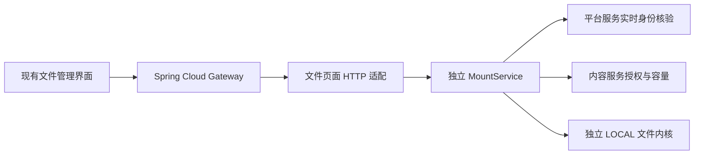

# 独立微服务 · 文件管理与本轮验收

日期：2026-10-26 · 开发版本 `0.1.0-SNAPSHOT`

本轮继续执行现有 Spring Cloud 重写计划。新增代码位于 `backend-independent/`，不调用旧后端实现；现有页面主题和角色动画保留，前端只补私有下载的必要适配。未部署、未切换当前前端的代理，也未提交或推送 Git。

## 1. 已打通的业务

适配层负责请求和返回格式；目录隔离、授权、容量、路径安全和真实文件操作仍由独立核心执行。没有把旧文件服务装入新服务，也没有在 HTTP 层另写一套磁盘操作。

| 操作 | 当前行为 |
| --- | --- |
| 云盘列表 | 返回页面需要的名称、标识和类型；不返回服务器物理目录 |
| 目录浏览 | 支持中文目录；返回文件名、父目录、大小、修改时间与类型 |
| 文件详情 | 支持完整虚拟路径，或父目录与文件名 |
| 目录权限 | 每次读取当前授权；页面按钮与后端能力一致 |
| 新建、重命名 | 调用独立文件内核，不覆盖同名目标 |
| 复制、移动 | 限同一云盘；最多20项，先验证所有路径语法，再逐项返回实际结果 |
| 删除 | 最多20项；参数格式错误时不删除任何项，文件不存在等运行错误按项返回 |
| 上传 | 先预检，再通过带登录头的 multipart PUT；实际写入时再次核验授权、配额与目录状态 |
| 下载 | 登录头鉴权，不把会话 Token 拼入地址；成员只能读取其可见根内的文件 |
| 撤销权限 | 已生成的上传地址不能保留旧权限，实际 PUT 仍会被拒绝 |

普通管理员申请本地盘、全局批准、成员申请开通、所属普通管理员审核并设置容量的链路，也在本次文件联调中实际执行。

## 2. 页面接口

| 方法 | 路径 | 说明 |
| --- | --- | --- |
| GET | `/api/storage/list` | 页面云盘列表；类型标记 `INDEPENDENT_LOCAL` |
| POST | `/api/storage/files` | `storageKey`、`path` → `data.files` |
| POST | `/api/storage/file/item` | 单个文件或目录信息 |
| POST | `/api/site/config/storage` | 目录权限和真实存储能力 |
| GET | `/api/site/config/userRootPath/{key}` | 私有虚拟根 `/`，不是物理授权目录 |
| POST | `/api/file/operator/mkdir` | `storageKey`、`path`、`name` |
| POST | `/api/file/operator/rename/file`、`folder` | 父目录、原名、新名 |
| POST | `/api/file/operator/copy/file`、`folder` | 来源及目标名称列表 |
| POST | `/api/file/operator/move/file`、`folder` | 来源及目标名称列表 |
| POST | `/api/file/operator/delete/batch` | `deleteItems` 内包含父目录和名称 |
| POST | `/api/file/operator/upload/file` | 预检后返回相对上传地址，不包含登录凭据 |
| PUT / POST | `/api/drives/{key}/files?path=...` | 上传；保留独立接口并兼容现有 PUT 调用 |
| GET | `/api/drives/{key}/content?path=...` | 带登录头下载 |
| POST | `/api/uploads/resumable/capabilities` | 如实返回 `enabled:false`，回退普通上传 |

原 `/api/drives` 保留独立的 `MountView` 返回格式。页面 DTO 单独适配，避免改变新 API 的已有使用者。

文件条目的 `path` 是父目录；下载地址中的 `path` 是完整的、相对本用户虚拟根的文件路径。用户无需知道 `/members/u...` 等内部布局。

现有表格直接显示 `time`，因此页面 DTO 返回北京时间 `yyyy-MM-dd HH:mm:ss`，另保留 `modifiedAt` 毫秒值。批量结果使用现有弹窗读取的 `message` 字段，避免失败原因空白；这两处均先复现不匹配，再通过接口回归验证。

## 3. 私有下载与资源预算

- 仅 `authenticatedContent:true` 条目使用新的带头下载流程；旧后端条目沿用原有行为。
- 下载地址只接受当前云盘的相对内容接口，拒绝外部地址、重复路径参数及额外参数，防止把登录头发给其它站点。
- 等待确认或下载期间切换账号、目录或权限，会关闭本次专属确认框并取消请求；晚到的旧响应不触发保存。
- 保存后释放临时 Blob 地址。当前浏览器实现为 Blob 下载，限制50MiB、最多两路、120秒超时；更大文件和流式保存仍需继续实现。
- 上传限制50MiB。POST 与 PUT 共用解析 multipart 前的两路并发预算；网关不为写操作自动重试。
- 预览、公开直链、短链、分享、打包下载和断点续传保持关闭，不能把尚未实现的按钮标记为可用。

当前目录仍是有上限的全量读取，文件核算也不是常数时间容量账本；大目录分页、账本与崩溃恢复属于后续任务。

## 4. 实际验证结果

| 检查 | 结果与范围 |
| --- | --- |
| 账号定向测试 | 41通过，失败0、跳过0；包含新增7项找回隐私回归 |
| 文件 HTTP 适配与授权输入 | 10通过，失败0、跳过0：页面适配9、成员授权契约1 |
| 上传解析前预算 | 1通过，失败0、跳过0；POST/PUT 共用上限及释放 |
| 前端定向回归 | 9个相关测试文件合计129通过，失败0、跳过0 |
| Maven 构建 | 最终15个子模块 `-DskipTests package` 成功，依赖边界规则通过 |
| 网关真实进程联调 | 平台、内容、网关三个独立 Java 进程；本次使用临时 H2 MySQL 模式，6组流程通过 |
| 部署配置 | 本地、ECS A、ECS B 三份 Compose 配置解析检查通过；未构建或运行正式镜像 |
| 代码复核 | 修复专属下载确认取消及批量删除预验证问题后，定向规格和质量复核通过 |

本次6组 HTTP 验证覆盖：

1. 页面存储类型、私有虚拟根、匿名拒绝与物理路径不外泄。
2. 成员审批后目录能力、禁止伪造预览/公开下载能力。
3. 中文目录、上传预检、真实 PUT multipart、目录显示、Bearer 与现有自定义登录头下载。
4. 成员之间及管理员私人目录隔离、其它成员读取拒绝、路径穿越拒绝。
5. 重命名、复制、移动、部分删除失败的真实结果。
6. 同名不覆盖、容量不足拒绝、无效批量路径不先删文件、权限修改不要求审批字段、旧上传地址在撤权后失效。

检查结束后临时进程全部停止，没有遗留测试监听端口。临时账号、随机测试密码和服务密钥未用于真实环境，也没有写入源代码。

此前邮箱注册联调使用过真实临时 **MySQL8.4.11** 与本地 SMTP。本次文件最终联调用 H2，不能把两者混写为文件流程已经在 MySQL 上重测。详细历史证据见 [邮箱与入驻记录](邮箱注册与空间入驻实施记录-2026-10-26.md)。

文件适配实现过程中，额外执行的一轮内容服务依赖测试为181项、零失败、4项环境跳过；跳过的是 Windows 环境不具备符号链接创建条件的 `LocalFileStoreTest` 三项和 `MountServiceTest` 一项。这不影响上表本轮52项定向检查的零跳过结果，但符号链接防护仍需在 Linux 环境验收。之后的最后两项修复已单独执行红→绿回归，未重复整轮依赖测试。

## 5. 仍需完成

这不是整个重写项目的上线验收。其它存储协议、全量管理页接口、文件预览/分享/续传、课程页面完整联调、模型/RAG/真实 Agent 执行、容量账本和恢复、业务缓存、全局统计与 ECS 验收仍需继续实施。

邮箱注册与找回业务已接通，真实 QQ SMTP 尚未配置验证。找回请求已统一冷却/次数及供应商结果响应，但同步发信仍可能产生时延差异，需要后续异步邮件任务进一步隔离。

[架构与实施计划](Spring-Cloud微服务架构与实施计划.md) · [独立后端说明](../backend-independent/README.md) · [两台 ECS 部署模板](../backend-independent/deploy/microservices/README.md)
